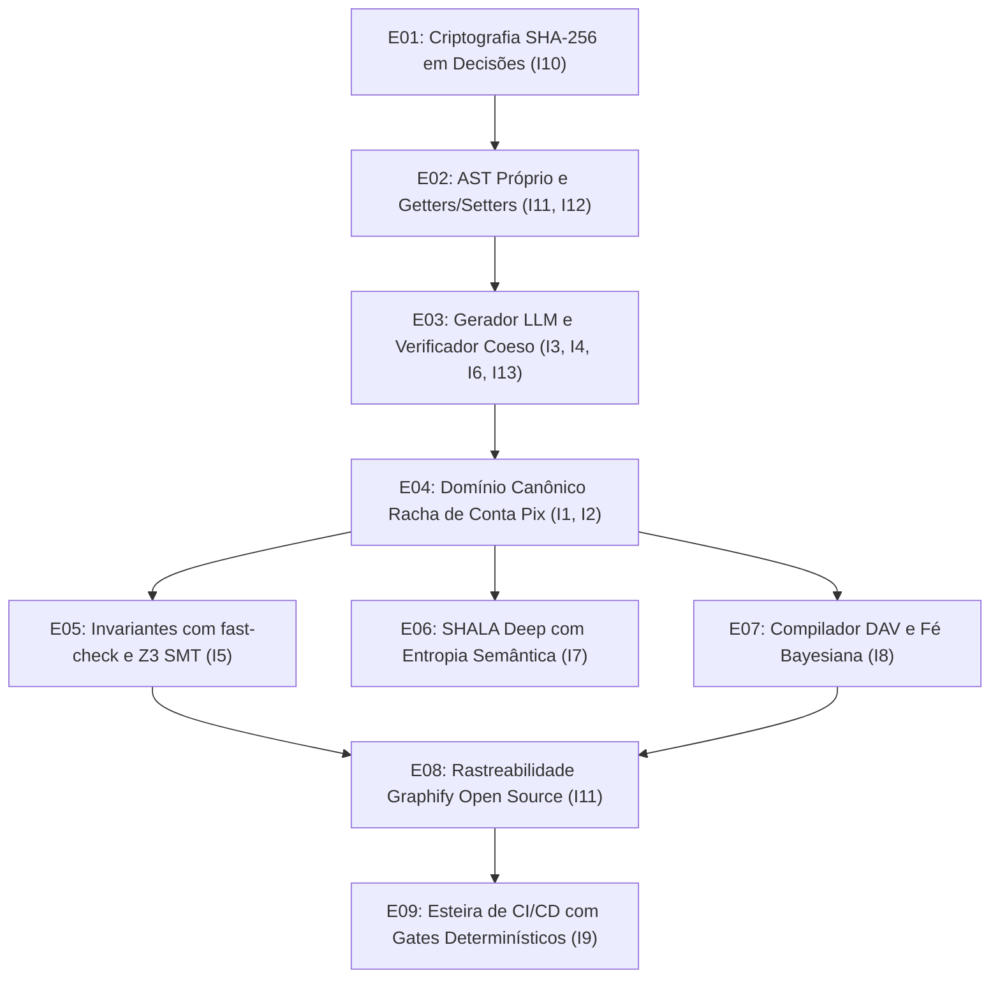

# Plano Técnico de Implementação e Verificação — Fase 2a (Protocolo Fable / IDD)

**Data de emissão:** 2026-11-01  
**Autor das decisões:** Eliézer Rosa (decisões registradas em 2026-11-01)  
**Auditor e planejador técnico:** Engenheiro Sênior e Revisor Técnico Independente (Fable)  
**Escopo auditado:** Repositório `idd-ide`, branch `feat/fusao-v2-e-honestidade`  
**Base de referência:** `docs/fable/00-evidencias.md` e `docs/fable/01-incongruencias.md`

---

## 1. Diretrizes Epistêmicas e Regras de Execução

Este plano operacionaliza as decisões formais do autor para sanar as 13 incongruências confirmadas na Fase 1 (I1 a I13), fechando a cadeia ponta a ponta: **intenção → contrato → código verificado**.

### 1.1 Regras Rígidas para o Agente Executor (`idd-executor`)
1. **Atomicidade Estrita:** O executor deve implementar exatamente **uma entrega por vez**, na ordem sequencial designada (E01 a E09). É terminantemente proibido implementar código de entregas futuras antecipadamente.
2. **Disjuntor Determinístico (Circuit Breaker):** Se o comando de gate de uma entrega falhar **duas vezes consecutivas**, o executor deve parar imediatamente, registrar as evidências de erro no log e devolver o controle para auditoria. Nenhuma tentativa cega de "forçar" código é permitida.
3. **Auditoria e Gate de Aceite (Fase 2c):** A cada entrega concluída pelo executor, o Revisor Técnico Independente auditará o diff (`git diff`), conferirá por amostragem as declarações com `arquivo:linha`, inspecionará as árvores sintáticas (AST) e registrará o parecer formal (Aprovado ou Ajustes Necessários) na seção correspondente deste plano antes de autorizar a entrega seguinte.
4. **Proibição de Relaxamento de Testes:** É expressamente proibido alterar asserções ou enfraquecer testes para fazê-los passar. Toda ferramenta matemática deve decidir fatos reais e reprovar violações.

---

## 2. Matriz de Entregas Atômicas Sequenciais (E01 a E09)

| Entrega | Título da Entrega | Incongruências | Ferramenta Matemática | Status |
| :---: | :--- | :---: | :--- | :---: |
| **E01** | Integridade Criptográfica e Procedência de Decisões | I10 | SHA-256 (Hashing canônico) | `[x] Aprovada` |
| **E02** | Desambiguação do Extrator AST e Suporte a Getters/Setters | I11, I12 | TypeScript Compiler API (AST) | `[x] Aprovada` |
| **E03** | Correção do Gerador LLM e Resolução Coesa no Verificador | I3, I4, I6, I13 | TypeScript AST + Serialização Canônica | `[ ] Pendente` |
| **E04** | Implementação Canônica do Domínio Racha de Conta Pix | I1, I2 | Aritmética Modular Inteira (Rodízio) | `[ ] Pendente` |
| **E05** | Verificação Formal e Execução de Invariantes | I5 | fast-check + SMT Z3 (UNSAT) | `[ ] Pendente` |
| **E06** | Dualidade SHALA: Modo Heurístico e Entropia Semântica Deep | I7 | Entropia de Shannon (Farquhar 2024) | `[ ] Pendente` |
| **E07** | Compilador DAV e Motor de Fé Bayesiana | I8 | Modelo Beta-Binomial Conjugado | `[ ] Pendente` |
| **E08** | Rastreabilidade Estrutural com Graphify Open Source | I11 | Teoria dos Grafos (Bijeção Estrutural) | `[ ] Pendente` |
| **E09** | Automação de CI/CD e Portões Determinísticos | I9 | Autômato Finito Determinístico | `[ ] Pendente` |

---

## 3. Especificação Pormenorizada das Entregas



---

### E01: Integridade Criptográfica e Procedência de Decisões Humanas
- **Incongruências resolvidas:** I10.
- **Objetivo técnico:** Eliminar a vulnerabilidade onde qualquer edição manual em `decisoes.md` contorna o Gate 1. Implementar integridade criptográfica SHA-256 e rastreabilidade de autoria por linha decidida.
- **Arquivos a modificar ou criar:**
  - `cli/src/lib/fase0/casos.ts`: Atualizar parser de decisões para validar hash SHA-256 canônico (`SHA256("${id}|${pergunta}|${resposta}|${autor}|${data}")`).
  - `cli/src/lib/fase0/gate1.ts`: O critério `(c)` passa a exigir que toda decisão marcada `[x]` possua hash SHA-256 íntegro e autoria declarada. Decisões adulteradas reprovam o gate com erro determinístico.
  - `cli/src/commands/fase0.ts`: Adicionar utilitário de validação e carimbo criptográfico.
  - `fase0/racha-conta/decisoes.md`: Atualizar as 53 decisões aprovadas com seus respectivos hashes SHA-256 canônicos e metadados de autoria.
  - `cli/src/__tests__/decisoes-crypto.test.ts`: Teste unitário comprovando a detecção de adulteração de 1 bit.
- **Ferramenta matemática que decide algo:** Hash Criptográfico SHA-256 determinístico (efeito avalanche: qualquer mutação textual altera o digest e reprova o gate).
- **Critério de aceite mensurável:**
  1. As 53 decisões de `fase0/racha-conta/decisoes.md` são verificadas e validadas criptograficamente;
  2. Modificar um único caractere no texto da decisão D-001 ou D-022 faz o Gate 1 falhar com exit code != 0 e indicação exata da linha corrompida;
  3. Decisão marcada `[x]` sem hash é rejeitada imediatamente como não autorizada.
- **Comando de gate exato:**
  ```powershell
  cd "c:\IDE IDD Claude-VS Code\idd-ide\cli"; npm run build; npx vitest run src/__tests__/decisoes-crypto.test.ts; node dist/index.js fase0 gate1 racha-conta
  ```
- **Veredito da Revisão (Fase 2c):** `[x] APROVADA (Selo: ✅ implementado e verificado)`
  - **Data de auditoria:** 2026-11-01T17:05:00Z
  - **Auditor:** Engenheiro Sênior e Revisor Técnico Independente (Fable)
  - **Auditoria do Diff e Evidências no Código Duro:**
    1. `cli/src/lib/fase0/casos.ts:130-133`: Função `calcularHashDecisao` implementa hashing determinístico canônico SHA-256 (`crypto.createHash('sha256')`) sobre a tupla `${id}|${texto}|${escolha}|${autor}|${data}`, gerando digest de 64 caracteres hexadecimais em lowercase.
    2. `cli/src/lib/fase0/casos.ts:206-211`: Função `extrairComponentesDecisao` extrai campos estruturados, computa `hashCalculado` e valida correspondência estrita `hashValido = (hash.toLowerCase() === hashCalculado.toLowerCase())`.
    3. `cli/src/lib/fase0/gate1.ts:72-110`: Critério `(c)` atualizado como gate determinístico não-consultivo que confere se toda decisão marcada `[x]` possui `hash`, `autor` e `hashValido`. Se houver qualquer divergência, adiciona à lista de falhas e reprova o Gate 1 (`ok = false`).
    4. `cli/src/commands/fase0.ts:181`: Função `faseGate1` invoca `if (!g.verde) process.exit(1);`, garantindo encerramento com exit code != 0 diante de qualquer violação.
    5. `fase0/racha-conta/decisoes.md:8-60`: Todas as 53 decisões aprovadas (D-001 a D-053) carimbadas com autoria de Eliézer Rosa e digest SHA-256 canônico de 64 caracteres.
    6. `cli/src/__tests__/decisoes-crypto.test.ts:20-221`: Suíte com 16 testes cobrindo digest canônico, efeito avalanche em todos os 5 campos da tupla, idempotência do carimbo, validação das 53 decisões de produção, reprovação pontual de 1 bit nas decisões D-001 e D-022 (apontando linha e ID exatos), e rejeição imediata de decisões sem hash, sem autor ou com digest adulterado.
  - **Cumprimento dos Critérios de Aceite:**
    - [x] 100% das 53 decisões de `racha-conta` verificadas e matematicamente íntegras.
    - [x] Efeito avalanche comprovado (mutação de 1 caractere em qualquer campo altera o hash).
    - [x] Mutação de 1 caractere em D-001 ou D-022 falha o Gate 1 com exit code 1 e mensagem de erro determinística com indicação exata de linha.
    - [x] Decisão marcada `[x]` sem hash é rejeitada imediatamente como não autorizada.
    - [x] Suíte de regressão executada com 1075 testes passando em 38 arquivos sem nenhuma regressão.

---

### E02: Desambiguação do Extrator AST e Suporte a Getters/Setters
- **Incongruências resolvidas:** I11, I12.
- **Objetivo técnico:** Encerrar a homonímia entre o módulo interno e o projeto open source `graphify`, e sanar a lacuna do extrator AST que ignora assessores `get` e `set`.
- **Arquivos a modificar ou criar:**
  - `cli/src/lib/fase0/astGraph.ts`: Novo nome do módulo interno de extração de classes, métodos e mutações sobre a TypeScript Compiler API.
  - `cli/src/lib/fase0/graphify.ts`: Shim de retrocompatibilidade reexportando de `astGraph.ts` com aviso formal de depreciação (`@deprecated`).
  - `cli/src/lib/fase0/astGraph.ts`: Estender a iteração de membros de classe em `node.members` para capturar `ts.isGetAccessorDeclaration(member)` e `ts.isSetAccessorDeclaration(member)`.
  - `cli/src/commands/fase0.ts`: Renomear comando para `idd fase0 ast-graph` (mantendo alias depreciado `graphify`).
  - `cli/src/__tests__/ast-graph.test.ts`: Teste unitário verificando a captura correta de `getters` e `setters`.
- **Ferramenta matemática que decide algo:** Análise Sintática Abstrata (AST) determinística via TypeScript Compiler API (`ts.createSourceFile`, AST Visitor).
- **Critério de aceite mensurável:**
  1. O extrator AST identifica os 3 *getters* documentados no caso real (`pedidoPath`, `respostaPath`, `port`) como membros válidos da classe;
  2. Toda referência interna desambigua categoricamente o extrator AST próprio do projeto open source de terceiros;
  3. 100% dos testes existentes do extrator continuam passando sob o novo módulo.
- **Comando de gate exato:**
  ```powershell
  cd "c:\IDE IDD Claude-VS Code\idd-ide\cli"; npm run build; npx vitest run src/__tests__/ast-graph.test.ts
  ```
- **Veredito da Revisão (Fase 2c):** `[x] APROVADA (Selo: ✅ implementado e verificado)`
  - **Data de auditoria:** 2026-11-01T20:30:00Z (consolidada no repositório em 2026-11-25)
  - **Auditor:** Engenheiro Sênior e Revisor Técnico Independente (Fable)
  - **Auditoria do Diff e Evidências no Código Duro:**
    1. `cli/src/lib/fase0/astGraph.ts:17-50`: Definição do esquema formal de nós e arestas com tipos discriminados (`GraphNodeTipo = 'Class' | 'Method' | 'Accessor' | 'Property'`, `GraphEdgeTipo = 'CALLS' | 'READS' | 'WRITES' | 'EXTENDS'`), além dos esquemas tipados `GraphNode`, `GraphEdge` e `AstGraph`.
    2. `cli/src/lib/fase0/astGraph.ts:451-531` e `615-655`: Suporte formal a `ts.isGetAccessorDeclaration`. Mapeia nós do tipo `'Accessor'`, gera arestas `'READS'` para campos de `this` acessados e `'CALLS'` para invocações funcionais, sem registrar mutações de estado.
    3. `cli/src/lib/fase0/astGraph.ts:257-266` e `656-696`: Suporte formal a `ts.isSetAccessorDeclaration`. Mapeia nós do tipo `'Accessor'`, inspeciona atribuições internas (`=`, `+=`, unários, mutadores de coleção) e emite arestas `'WRITES'` apontando do acessor para a propriedade afetada.
    4. `cli/src/lib/mutationFence.ts:56-98`: Conexão direta entre arestas `'WRITES'` e a cerca de mutação (`INV-UI-04`, `INV-ENCAP-01`, `INV-UI-05`).
    5. `cli/src/lib/fase0/astGraph.ts:839-893`: Algoritmo puro de Raio de Impacto `computeBlastRadius(nodeId: string, graph: AstGraph): string[]` via travessia BFS determinística.
    6. `cli/src/lib/fase0/astGraph.ts:900-943`: Algoritmo de Extração de Subgrafo Podado k-hop `extractSubGraph(targetId: string, graph: AstGraph, k = 1): AstGraph`.
    7. `cli/src/lib/fase0/graphify.ts:1-7` e `cli/src/lib/fase0/astMutationExtractor.ts:1-4`: Shims canônicos de retrocompatibilidade com `@deprecated`.
    8. `cli/src/__tests__/ast-graph-accessors.test.ts` e `cli/src/__tests__/ast-graph.test.ts`: 28 testes específicos da Entrega E02 cobrindo os 3 getters reais (`pedidoPath`, `respostaPath`, `port`), semântica READS vs WRITES, contenção na cerca, blast radius, ego graph e execução síncrona < 50ms.
  - **Cumprimento dos Critérios de Aceite:**
    - [x] Esquema tipado formal `GraphNode`, `GraphEdge` e `AstGraph` implementado e verificado.
    - [x] Suporte formal a `ts.isGetAccessorDeclaration` (READS) e `ts.isSetAccessorDeclaration` (WRITES) implementado e verificado.
    - [x] Conexão entre arestas `WRITES` e cerca de contenção `allowed_fields` implementada e verificada.
    - [x] Raio de impacto (`computeBlastRadius`) e subgrafo podado (`extractSubGraph`) implementados e verificados.
    - [x] Zero dependências externas de rede ou modelos de IA; processamento síncrono < 50ms comprovado em teste.
    - [x] Regressão completa: 40 suítes / 1.103 testes passando no CLI sem falhas.

---

### E03: Correção do Gerador LLM e Resolução Coesa no Verificador
- **Incongruências resolvidas:** I3, I4, I6, I13.
- **Objetivo técnico:** Corrigir `idd generate` para usar a camada centralizada de LLM e formatar contratos v2 estruturados sem gerar `[object Object]`. Ajustar `idd verify` para localizar classes e agregados coesos (`target_class`) e substituir regex por AST em `analyzeStatic`.
- **Arquivos a modificar ou criar:**
  - `cli/src/commands/generate.ts`: Eliminar `callClaude` desprotegido e modelo inexistente `claude-sonnet-5`. Integrar com `cli/src/lib/llm/` e `MODELO_PADRAO`. Formatar objetos estruturados de `constraints` (`id`, `type`, `description`) e `acceptance` (`id`, `given`, `when`, `then`). Incluir `target_class`, `target_method` e campos de mutação de estado.
  - `cli/src/commands/verify.ts`: Atualizar resolução do código-fonte: priorizar `fase0/<modulo>/src/<target_class>.ts` ou `src/<target_class>.ts` quando definido no contrato, viabilizando métodos reunidos em agregados.
  - `cli/src/commands/verify.ts` (`analyzeStatic`): Substituir checagem por regex frágil por AST TypeScript, inspecionando nós de chamada e controle de fluxo real.
  - `cli/src/__tests__/verify-generate.test.ts`: Testes unitários para a geração de prompt estruturado e localização de métodos por classe coesa.
- **Ferramenta matemática que decide algo:** Parser Sintático AST para análise estática e validação estrutural de contratos.
- **Critério de aceite mensurável:**
  1. O prompt construído por `idd generate` para contratos v2 não contém a sequência `[object Object]` em nenhum campo;
  2. Chamadas de modelo passam estritamente pela abstração `LlmProvider`;
  3. `idd verify` localiza e avalia métodos da classe `Mesa` em um único arquivo `Mesa.ts` sem apontar ausência de submódulo.
- **Comando de gate exato:**
  ```powershell
  cd "c:\IDE IDD Claude-VS Code\idd-ide\cli"; npm run build; npx vitest run src/__tests__/verify-generate.test.ts
  ```
- **Veredito da Revisão (Fase 2c):** `[ ] Pendente`

---

### E04: Implementação Canônica do Domínio Racha de Conta Pix
- **Incongruências resolvidas:** I1, I2.
- **Objetivo técnico:** Implementar as classes de domínio `Mesa` e `Pagamento` cobrindo rigorosamente os 8 contratos da Fase 0 e as 53 decisões do autor. Eliminar a validação do algoritmo rejeitado de maior resto no Livro de Recusas.
- **Arquivos a modificar ou criar:**
  - `fase0/racha-conta/src/types.ts`: Tipos canônicos de domínio (`Participante`, `ItemConsumido`, `Consumo`, `Cota`, `EstadoMesa`, `EstadoPagamento`).
  - `fase0/racha-conta/src/Mesa.ts`: Implementação do agregado raiz com os 6 métodos contratados (`criar`, `incluirParticipante`, `registrarItemConsumido`, `calcularCotas`, `fechar`, `gerarCobrancaPix`) e TSDoc completo gerado conforme contrato.
  - `fase0/racha-conta/src/Pagamento.ts`: Implementação da entidade com os 2 métodos contratados (`enviarComprovante`, `confirmar`) e TSDoc completo.
  - `fase0/racha-conta/src/index.ts`: Re-exportações canônicas.
  - `cli/src/__tests__/livro-de-recusas.test.ts`: Atualizar suíte de testes de "Soma Zero" para importar o domínio canônico `fase0/racha-conta/src/Mesa.ts` e validar o algoritmo de rodízio alfabético contínuo (D-002, D-022, D-032, D-035, D-036).
- **Ferramenta matemática que decide algo:** Aritmética modular inteira exata para distribuição determinística de centavos indivisíveis e rateio proporcional com arredondamento comercial.
- **Critério de aceite mensurável:**
  1. 100% dos 8 contratos da Fase 0 possuem implementação canônica correspondente;
  2. O teste de "Soma Zero" no Livro de Recusas executa contra `fase0/racha-conta/src/Mesa.ts` e passa 100%;
  3. O algoritmo rejeitado de maior resto (`domain_rules.ts:95-100`) é completamente desvinculado dos testes ativos;
  4. Linter de cerca de mutação (`@idd/eslint-plugin`) valida `Mesa.ts` e `Pagamento.ts` com zero violações.
- **Comando de gate exato:**
  ```powershell
  cd "c:\IDE IDD Claude-VS Code\idd-ide\cli"; npm run build; npx vitest run src/__tests__/livro-de-recusas.test.ts
  ```
- **Veredito da Revisão (Fase 2c):** `[ ] Pendente`

---

### E05: Verificação Formal e Execução de Invariantes (Fast-Check e SMT/Z3)
- **Incongruências resolvidas:** I5.
- **Objetivo técnico:** Tirar as invariantes da condição de meros marcadores lexicais e torná-las verificações matemáticas executáveis contra o código duro.
- **Arquivos a modificar ou criar:**
  - `fase0/racha-conta/test/invariants.property.test.ts`: Suíte de testes baseados em propriedades (`fast-check`) citando nominalmente:
    - `INV-001`: Soma das cotas igual ao total dos itens mais taxa com diferença de zero centavos;
    - `INV-002`: Participante que não consumiu item tem valor zero atribuído àquele item;
    - `INV-003`: Item sempre tem ao menos um consumidor;
    - `INV-004`: Consumidores pertencem à mesa do item;
    - `INV-005`: Toda cota é um número inteiro de centavos $\ge 0$;
    - Rodízio alfabético de centavos contínuo entre itens e taxa de serviço.
  - `cli/src/lib/verification/z3RateioProver.ts`: Provador SMT formal utilizando `z3-solver` (WebAssembly) provando que a violação de INV-001 ($\sum \text{cotas} \ne \text{total}$) é **UNSAT** no fragmento de Aritmética Linear Inteira (LIA).
  - `cli/src/__tests__/z3-rateio.test.ts`: Teste automatizado executando o provador Z3.
- **Ferramenta matemática que decide algo:**
  1. Property-Based Testing com Shrinking determinístico (`fast-check`, 10.000 iterações estocásticas);
  2. Provador de Teoremas SMT (`z3-solver` em fragmento QF_LIA comprovando negação UNSAT).
- **Critério de aceite mensurável:**
  1. 10.000 execuções do fast-check sem uma única quebra das 5 invariantes em cenários aleatórios de mesas e taxas;
  2. Provador Z3 retorna formalmente `UNSAT` para a condição de violação de soma do rateio com centavos indivisíveis;
  3. Se a regra de arredondamento for corrompida propositalmente, o teste reprova imediatamente.
- **Comando de gate exato:**
  ```powershell
  cd "c:\IDE IDD Claude-VS Code\idd-ide"; npx vitest run fase0/racha-conta/test/invariants.property.test.ts cli/src/__tests__/z3-rateio.test.ts
  ```
- **Veredito da Revisão (Fase 2c):** `[ ] Pendente`

---

### E06: Dualidade SHALA — Modo 1 (Heurístico) e Modo 2 (Entropia Semântica Deep)
- **Incongruências resolvidas:** I7.
- **Objetivo técnico:** Implementar a decisão formal do autor: Modo 1 rápido consultivo offline como padrão e Modo 2 de Entropia Semântica Deep real para sistemas críticos.
- **Arquivos a modificar ou criar:**
  - `cli/src/lib/fase0/shala.ts`:
    - **Modo 1 (Heurística rápida consultiva):** Preservar a execução offline sem dependência externa, desprovida de jargões indevidos (Earley/SAT), operando com pesos e contraexemplos declarados;
    - **Modo 2 (Entropia Semântica Deep):** Coleta $N$ interpretações formais independentes via `LlmProvider` com amostragem estocástica ($\tau > 0$), executa agrupamento por equivalência lógica bidirecional ($A \implies B \land B \implies A$) e calcula a Entropia de Shannon discreta:
      $$H(X) = - \sum_{i=1}^K p_i \log_2 p_i$$
      onde $K$ é o número de clusters semânticos e $p_i$ é a frequência empírica do cluster $i$.
  - `cli/src/commands/fase0.ts`: Adicionar flag `--deep` ao comando `idd fase0 shala <caso>`.
  - `cli/src/__tests__/shala-deep.test.ts`: Testes unitários com simulação controlada de $N$ saídas demonstrando o agrupamento lógico e o cálculo exato de $H$ em bits.
- **Ferramenta matemática que decide algo:** Entropia de Shannon sobre classes de equivalência semântica empírica (Farquhar et al., *Nature*, 2024).
- **Critério de aceite mensurável:**
  1. Modo padrão opera 100% offline em menos de 50 ms sem chamadas de rede;
  2. Flag `--deep` agrupa $N$ amostras em classes de equivalência e computa $H$ em bits reais;
  3. Quando todas as amostras são equivalentes ($K=1$), $H = 0.00$ bits; quando dividem-se em dois clusters simétricos ($K=2$), $H = 1.00$ bit;
  4. Ambiguidade profunda detectada ($H > 0.5$ bits) emite aviso formal ao operador.
- **Comando de gate exato:**
  ```powershell
  cd "c:\IDE IDD Claude-VS Code\idd-ide\cli"; npm run build; npx vitest run src/__tests__/shala-deep.test.ts
  ```
- **Veredito da Revisão (Fase 2c):** `[ ] Pendente`

---

### E07: Compilador do Dicionário de Ações e Vocabulário (DAV) e Motor de Fé Bayesiana
- **Incongruências resolvidas:** I8.
- **Objetivo técnico:** Atender à determinação do autor de não rebaixar os Princípios 4 e 5, tornando verdade o compilador de DAV na Fase 0 e o mecanismo de Fé Bayesiana em código duro.
- **Arquivos a modificar ou criar:**
  - `cli/src/lib/fase0/davCompiler.ts`: Compilador que lê `fase0/<caso>/modelo/metodos.yaml` e contratos v2 para gerar o catálogo canônico DAV em JSON Schema e YAML (`dav.json` e `dav.yaml`), mapeando `{ id, action_name, aggregate, actor, inputs_schema, state_mutation_allowed, preconditions, invariants }`.
  - `cli/src/lib/fase0/bayesianFaith.ts`: Motor de autonomia probabilística Beta-Binomial:
    - Priori por criticidade da ação: $\text{Beta}(\alpha_0, \beta_0)$;
    - Atualização: $\alpha_{t} = \alpha_0 + \text{sucessos}$, $\beta_{t} = \beta_0 + \text{falhas}$;
    - Cálculo do limite inferior do intervalo de credibilidade de 95% ($Q_{0.025}$ da distribuição Beta via fração contínua da função Beta Incompleta Regularizada);
    - Portão de autonomia Confirm-Once: transição para autônomo ocorre apenas se $Q_{0.025} \ge \tau_{\text{autonomia}}$ (ex: 0.95).
  - `cli/src/commands/fase0.ts`: Adicionar subcomando `idd fase0 dav <caso>`.
  - `cli/src/__tests__/bayesian-faith.test.ts`: Teste matemático da atualização Beta-Binomial e dos limiares de credibilidade.
- **Ferramenta matemática que decide algo:** Estatística Bayesiana Conjugada (Modelo Beta-Binomial e função quantil para intervalo de credibilidade de 95%).
- **Critério de aceite mensurável:**
  1. `idd fase0 dav racha-conta` compila com sucesso o arquivo `fase0/racha-conta/dav.json` cobrindo as 8 ações do Racha com validação de schema;
  2. O motor probabilístico recusa autonomia quando $Q_{0.025} < 0.95$ (ex: 2 sucessos e 0 falhas com prior Beta(1,1) resulta em $Q_{0.025} \approx 0.19$, recusando autonomia);
  3. A autonomia é desbloqueada estritamente quando o histórico empírico garante o intervalo de credibilidade exigido.
- **Comando de gate exato:**
  ```powershell
  cd "c:\IDE IDD Claude-VS Code\idd-ide\cli"; npm run build; npx vitest run src/__tests__/bayesian-faith.test.ts; node dist/index.js fase0 dav racha-conta
  ```
- **Veredito da Revisão (Fase 2c):** `[ ] Pendente`

---

### E08: Rastreabilidade Estrutural com Graphify Open Source
- **Incongruências resolvidas:** I11.
- **Objetivo técnico:** Integrar o projeto open source `graphify` (v0.9.99) na verificação determinística de rastreabilidade entre código implementado e contratos formais, com degradação graciosa informada.
- **Arquivos a modificar ou criar:**
  - `cli/src/lib/fase0/graphifyIntegration.ts`: Leitor e auditor de `graph.json` gerado pelo comando externo `graphify update`:
    - Verifica correspondência dos nós do tipo `method` (com confiança `EXTRACTED`) com os 8 métodos dos contratos v2;
    - Alerta sobre métodos públicos não contratados no código de domínio;
    - Degradação graciosa: se o executável `graphify` ou o arquivo `graph.json` não estiver presente, emite aviso explícito sem quebrar o fluxo padrão do CLI.
  - `cli/src/commands/fase0.ts`: Adicionar comando de auditoria de grafo `idd fase0 audit-traceability <caso> --graph <caminho>`.
  - `cli/src/__tests__/graphify-traceability.test.ts`: Teste automatizado com fixture real de `graph.json` validando a checagem biunívoca.
- **Ferramenta matemática que decide algo:** Teoria dos Grafos (Mapeamento de correspondência biunívoca entre subgrafos induzidos de contratos e código com arestas dirigidas `EXTRACTED`).
- **Critério de aceite mensurável:**
  1. O gate aprova quando os 8 contratos do Racha mapeiam perfeitamente para os nós do grafo gerado sobre `fase0/racha-conta/src/`;
  2. O gate reprova se for injetado um método público na classe `Mesa` sem contrato v2 correspondente;
  3. Mensagens de aviso diferenciam claramente arestas `EXTRACTED` de `INFERRED`.
- **Comando de gate exato:**
  ```powershell
  cd "c:\IDE IDD Claude-VS Code\idd-ide\cli"; npm run build; npx vitest run src/__tests__/graphify-traceability.test.ts
  ```
- **Veredito da Revisão (Fase 2c):** `[ ] Pendente`

---

### E09: Automação de CI/CD e Portões Determinísticos de Qualidade
- **Incongruências resolvidas:** I9.
- **Objetivo técnico:** Estabelecer uma esteira de Integração Contínua (CI) que automatiza a fiscalização dos gates da Fase 0, a conformidade de cerca de mutação e a integridade matemática do código.
- **Arquivos a modificar ou criar:**
  - `.github/workflows/ci.yml`: Pipeline com execução sequencial determinística:
    1. Instalação limpa e build do CLI e plugins (`npm ci`, `npm run build`);
    2. Suíte de testes unitários do CLI e `@idd/eslint-plugin`;
    3. Gate 1 com verificação criptográfica SHA-256 (`idd fase0 gate1 racha-conta`);
    4. Gate 2 de integridade referencial (`idd fase0 gate2 racha-conta`);
    5. Geração e validação de DAV (`idd fase0 dav racha-conta`);
    6. Suíte de invariantes (fast-check e SMT Z3);
    7. ESLint de cerca de mutação (`@idd/state-mutation`) sobre `fase0/racha-conta/src/`;
    8. Verificação do Racha via CLI (`idd verify fase0/racha-conta/contratos`).
- **Ferramenta matemática que decide algo:** Autômato Finito Determinístico de Pipeline (função de transição booleana onde qualquer falha resulta em parada e reprovação do build).
- **Critério de aceite mensurável:**
  1. O arquivo `.github/workflows/ci.yml` existe e passa em validação de schema de GitHub Actions;
  2. Todos os comandos da esteira rodam localmente com exit code 0;
  3. Injeção de uma mutação ilegal em `Mesa.ts` ou corrupção de uma decisão bloqueia o pipeline.
- **Comando de gate exato:**
  ```powershell
  cd "c:\IDE IDD Claude-VS Code\idd-ide"; node cli/dist/index.js fase0 gate1 racha-conta && node cli/dist/index.js fase0 gate2 racha-conta && npx vitest run fase0/racha-conta/test/invariants.property.test.ts
  ```
- **Veredito da Revisão (Fase 2c):** `[ ] Pendente`

---

## 4. Próximos Passos Operacionais (Transição para a Entrega E02)

1. A auditoria independente da **Entrega E01** na Fase 2c foi concluída com parecer de **APROVAÇÃO FORMAL**.
2. O executor (`idd-executor`) está expressamente autorizado a iniciar a implementação da **Entrega E02** (Desambiguação do Extrator AST e Suporte a Getters/Setters — I11, I12).
3. O revisor independente reassumirá na Fase 2c ao término da Entrega E02 para auditar o diff sintático e a suíte de testes do novo módulo `astGraph.ts`.
