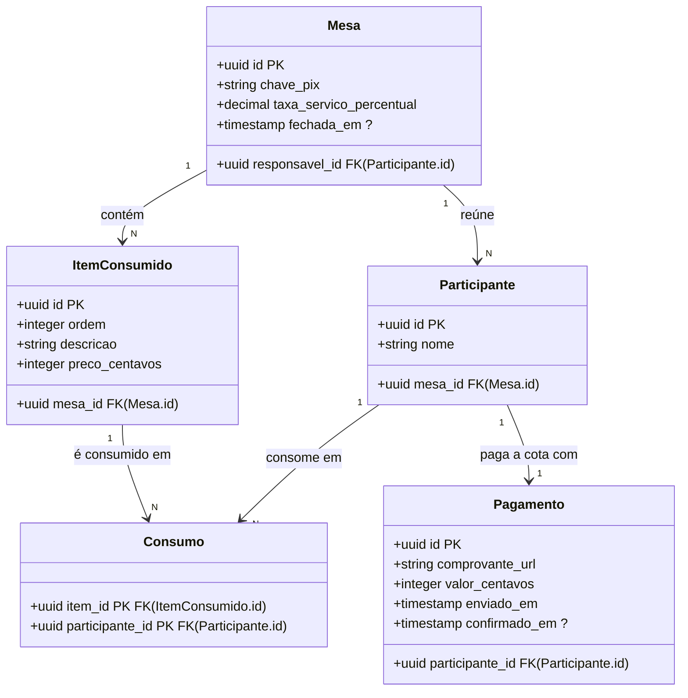

# Especificação Compilada (IDD Fase 0) — racha-conta

> Documento canônico determinístico gerado por `idd fase0 export` para consumo por humanos, Aider, Spec Kit e pipelines CI.
> Nenhum termo, invariante, entidade, transação ou método entrou nesta especificação sem decisão humana registrada (Comando Epistêmico).

## 1. Dicionário Ubíquo

| Termo | Tipo | Definição | Aliases | Proibidos |
| --- | --- | --- | --- | --- |
| **ChavePix** | `value-object` | Chave Pix do responsável da mesa, para a qual os participantes pagam as próprias cotas. | Chave Pix | — |
| **Cota** | `value-object` | Valor em centavos inteiros que um participante deve pagar: a parte dos itens que consumiu mais a parte proporcional da taxa de serviço. | Cota justa | — |
| **ItemConsumido** | `entity` | Produto ou serviço da nota (pizza, porção, bebida) com descrição, preço em centavos e o conjunto de participantes que o consumiram. | Item | — |
| **Mesa** | `aggregate` | Encontro de consumo (restaurante, bar, churrasco) que reúne os participantes, os itens consumidos e a taxa de serviço, e cuja nota é dividida entre os participantes. | Evento de rateio | — |
| **Nota** | `value-object` | Documento de cobrança emitido pelo estabelecimento, com o valor total a pagar pela mesa. | Nota do estabelecimento | Notinha |
| **Participante** | `entity` | Pessoa que integra uma mesa, pode consumir itens e deve pagar a própria cota. | Consumidor | — |
| **ResponsavelMesa** | `role` | Participante que recebe, na própria chave Pix, os pagamentos das cotas dos demais participantes da mesa. | Responsável da mesa | — |
| **TaxaServico** | `value-object` | Percentual cobrado pelo estabelecimento sobre o consumo (10% nas fontes), rateado entre os participantes em proporção ao que cada um consumiu. | Taxa de serviço, Gorjeta | — |

## 2. Intenções (EARS)

# Intenções — racha-conta

> Uma intenção por linha, no formato `- **INT-001** <frase>`, em EARS adaptado ao português.
> Termos de domínio entre colchetes duplos: [[Termo]] (devem existir em dicionario.json).
> Moldes: "O/A <sujeito> deve <resposta>." · "Quando <gatilho>, o/a <sujeito> deve ..." ·
> "Enquanto <estado>, ..." · "Se <condição>, então o/a <sujeito> deve ..." · "Onde <característica>, ..."
> Exemplo: `- **INT-001** Quando o cliente confirma o pedido, o [[Sistema]] deve registrar a venda.`
> Nada entra aqui sem decisão humana registrada em decisoes.md.
- **INT-001** O aplicativo deve dividir o preço de cada [[ItemConsumido]] somente entre os participantes que consumiram esse [[ItemConsumido]].
- **INT-003** O aplicativo deve exibir a cada [[Participante]] o valor exato da própria [[Cota]].
- **INT-004** O aplicativo deve permitir que cada [[Participante]] pague a própria [[Cota]] por Pix Copia e Cola ou QR Code para a [[ChavePix]] do [[ResponsavelMesa]].
- **INT-005** Quando o [[ResponsavelMesa]] cria a [[Mesa]], o aplicativo deve exigir a [[ChavePix]] do [[ResponsavelMesa]].

## 3. Invariantes de Domínio

# Invariantes — racha-conta

> Uma invariante por linha, no formato `- **INV-001** [tipo] <enunciado testável>`.
> Tipos: integridade, unicidade, temporal, autorização, cálculo, estado.
> O enunciado precisa de um marcador testável (sempre, nunca, deve, não pode, no máximo, no mínimo, exatamente, igual a, =, ≤, ≥, <, >).
> Exemplo: `- **INV-001** [integridade] Todo [[Pagamento]] sempre pertence a exatamente uma [[Conta]].`
- **INV-001** [cálculo] A soma das cotas de todos os participantes de uma [[Mesa]] deve ser exatamente igual à soma dos preços dos [[ItemConsumido]] mais a [[TaxaServico]], com diferença de zero centavos.
- **INV-003** [integridade] Todo [[ItemConsumido]] deve ter no mínimo um [[Participante]] entre os consumidores.
- **INV-004** [integridade] Todo [[Participante]] associado a um [[ItemConsumido]] deve pertencer à mesma [[Mesa]] do [[ItemConsumido]].
- **INV-005** [cálculo] Toda [[Cota]] deve ser um número inteiro de centavos, com valor ≥ 0.

## 4. Modelo Entidade-Relacionamento (BCNF / 3NF)

### Diagnóstico de Forma Normal (Fecho de Armstrong)

- **Mesa**: chaves {id} — BCNF
- **Participante**: chaves {id} {mesa_id, nome} — BCNF
- **ItemConsumido**: chaves {id} {mesa_id, ordem} — BCNF
- **Consumo**: chaves {item_id, participante_id} — BCNF
- **Pagamento**: chaves {id} {participante_id} — BCNF

## 5. Casos de Uso e Transações de Negócio

### UC-01 — Criar mesa (Ator: `ResponsavelMesa` · Intenções: INT-005)

- **TN-01 — Criar mesa com chave Pix**
  - **Pré-condições:** O [[ResponsavelMesa]] informou a própria [[ChavePix]] e o próprio nome.
  - **Pós-condições:** A [[Mesa]] existe, aberta, com a [[ChavePix]] do [[ResponsavelMesa]] e a [[TaxaServico]] informada, ou 10% se nenhuma foi informada. · O [[ResponsavelMesa]] é um [[Participante]] da [[Mesa]].
  - **Altera:** `Mesa`, `Participante`

### UC-02 — Registrar participantes e consumo (Ator: `ResponsavelMesa` · Intenções: INT-001)

- **TN-02 — Incluir participante**
  - **Pré-condições:** A [[Mesa]] não está fechada. · Nenhum [[Participante]] da [[Mesa]] tem o mesmo nome.
  - **Pós-condições:** O novo [[Participante]] pertence a exatamente uma [[Mesa]].
  - **Altera:** `Participante`
  - **Lê:** `Mesa.fechada_em`, `Participante.nome`
- **TN-03 — Registrar item com os consumidores**
  - **Pré-condições:** A [[Mesa]] não está fechada. · O [[ItemConsumido]] tem ao menos um consumidor. · Todo consumidor informado é [[Participante]] da mesma [[Mesa]] do [[ItemConsumido]]. · O preço do [[ItemConsumido]] é um número inteiro de centavos.
  - **Pós-condições:** O [[ItemConsumido]] recebe a próxima ordem de registro da [[Mesa]]. · Existe exatamente um Consumo para cada consumidor informado.
  - **Invariantes:** INV-003, INV-004
  - **Altera:** `ItemConsumido`, `Consumo`
  - **Lê:** `Mesa.fechada_em`, `Participante.mesa_id`, `ItemConsumido.ordem`

### UC-03 — Consultar a própria cota (Ator: `Participante` · Intenções: INT-001, INT-003)

- **TN-04 — Calcular as cotas da mesa**
  - **Pré-condições:** A [[Mesa]] tem ao menos um [[ItemConsumido]].
  - **Pós-condições:** O preço de cada [[ItemConsumido]] é dividido somente entre os [[Participante]]s que o consumiram. · O centavo indivisível de cada [[ItemConsumido]] vai, em rodízio, para o próximo [[Participante]] em ordem alfabética que ainda não recebeu nenhum, percorrendo os itens na ordem de registro. · O total da [[TaxaServico]] é o percentual da [[Mesa]] sobre a soma dos preços dos [[ItemConsumido]], com arredondamento comercial para centavos inteiros (meio centavo ou mais sobe). · A parte da [[TaxaServico]] de cada [[Participante]] é proporcional ao valor dos itens que ele consumiu; o centavo indivisível da taxa continua o rodízio alfabético a partir do [[Participante]] seguinte ao último que recebeu centavo dos itens. · A soma das [[Cota]]s é exatamente igual à soma dos preços dos [[ItemConsumido]] mais a [[TaxaServico]]. · Toda [[Cota]] é um número inteiro de centavos ≥ 0.
  - **Invariantes:** INV-001, INV-005
  - **Lê:** `ItemConsumido.preco_centavos`, `ItemConsumido.ordem`, `Consumo`, `Participante.nome`, `Mesa.taxa_servico_percentual`

### UC-04 — Fechar mesa (Ator: `ResponsavelMesa`)

- **TN-05 — Fechar a mesa para pagamento**
  - **Pré-condições:** A [[Mesa]] não está fechada.
  - **Pós-condições:** A [[Mesa]] tem a data de fechamento e não aceita novos [[Participante]]s, novos [[ItemConsumido]]s nem mudanças nos consumos.
  - **Altera:** `Mesa.fechada_em`

### UC-05 — Pagar a própria cota (Ator: `Participante` · Intenções: INT-004)

- **TN-06 — Gerar a cobrança Pix da cota**
  - **Pré-condições:** A [[Mesa]] está fechada. · O [[Participante]] não é o [[ResponsavelMesa]]. · A [[Cota]] do [[Participante]] é maior que zero.
  - **Pós-condições:** O aplicativo exibe o Pix Copia e Cola e o QR Code para a [[ChavePix]] da [[Mesa]], com o valor da [[Cota]] do [[Participante]].
  - **Invariantes:** INV-005
  - **Lê:** `Mesa.fechada_em`, `Mesa.chave_pix`
- **TN-07 — Enviar comprovante**
  - **Pré-condições:** A [[Mesa]] está fechada. · O [[Participante]] não é o [[ResponsavelMesa]]. · A [[Cota]] do [[Participante]] é maior que zero. · Nenhum pagamento do [[Participante]] está confirmado.
  - **Pós-condições:** Existe exatamente um pagamento do [[Participante]], com o comprovante e o valor da [[Cota]] em centavos no momento do envio; um comprovante anterior não confirmado é substituído.
  - **Altera:** `Pagamento`
  - **Lê:** `Mesa.fechada_em`, `Pagamento.confirmado_em`

### UC-06 — Confirmar pagamento (Ator: `ResponsavelMesa`)

- **TN-08 — Confirmar o pagamento de um participante**
  - **Pré-condições:** O pagamento tem comprovante e ainda não foi confirmado.
  - **Pós-condições:** O pagamento tem a data de confirmação.
  - **Altera:** `Pagamento.confirmado_em`
  - **Lê:** `Pagamento.comprovante_url`

## 6. Fluxos de Atividades

### UC-01 — O responsável informa o próprio nome, a chave Pix e a taxa de serviço opcional, e o sistema cria a mesa aberta.

1. **P-01** (`ResponsavelMesa`): Informa o próprio nome, a [[ChavePix]] e, opcionalmente, o percentual da [[TaxaServico]].
1. **P-02** (`Sistema`) [`TN-01`]: Cria a [[Mesa]] aberta com a [[ChavePix]] e a [[TaxaServico]] (ou 10% por padrão) e registra o [[ResponsavelMesa]] como [[Participante]].
   - *Guarda:* O [[ResponsavelMesa]] informou a própria [[ChavePix]] e o próprio nome.
   - *Senão:* Recusa a criação da [[Mesa]] e solicita o dado obrigatório ausente.

### UC-02 — Enquanto a mesa está aberta, o responsável inclui participantes com nomes únicos e registra os itens consumidos.

1. **P-01** (`ResponsavelMesa`): Informa o nome do novo [[Participante]] da [[Mesa]].
1. **P-02** (`Sistema`) [`TN-02`]: Inclui o [[Participante]] na [[Mesa]].
   - *Guarda:* A [[Mesa]] não está fechada e nenhum [[Participante]] da [[Mesa]] tem o mesmo nome.
   - *Senão:* Recusa a inclusão do [[Participante]] e informa o motivo.
1. **P-03** (`ResponsavelMesa`): Informa a descrição, o preço inteiro em centavos e os [[Participante]]s consumidores do [[ItemConsumido]].
1. **P-04** (`Sistema`) [`TN-03`]: Registra o [[ItemConsumido]] na próxima ordem da [[Mesa]] e associa cada [[Participante]] consumidor.
   - *Guarda:* A [[Mesa]] não está fechada, o [[ItemConsumido]] tem ao menos um consumidor da mesma [[Mesa]] e o preço é um número inteiro de centavos.
   - *Senão:* Recusa o registro do [[ItemConsumido]] e informa a regra violada.

### UC-03 — O participante solicita a consulta e o sistema calcula e exibe as cotas da mesa com centavos indivisíveis em rodízio alfabético.

1. **P-01** (`Participante`): Solicita a consulta da própria [[Cota]] na [[Mesa]].
1. **P-02** (`Sistema`) [`TN-04`]: Calcula as [[Cota]]s da [[Mesa]] (itens e [[TaxaServico]] com arredondamento comercial e rodízio alfabético contínuo) e exibe o valor exato da [[Cota]] ao [[Participante]].
   - *Guarda:* A [[Mesa]] tem ao menos um [[ItemConsumido]].
   - *Senão:* Informa que a [[Mesa]] ainda não possui [[ItemConsumido]] registrado para cálculo.

### UC-04 — O responsável encerra os lançamentos e fecha definitivamente a mesa para pagamento.

1. **P-01** (`ResponsavelMesa`): Solicita o fechamento da [[Mesa]] para pagamento.
1. **P-02** (`Sistema`) [`TN-05`]: Registra a data de fechamento da [[Mesa]] e bloqueia novas inclusões ou alterações de consumo.
   - *Guarda:* A [[Mesa]] não está fechada.
   - *Senão:* Informa que a [[Mesa]] já se encontra fechada.

### UC-05 — Com a mesa fechada, o participante gera a cobrança Pix da própria cota e envia o comprovante de pagamento.

1. **P-01** (`Participante`): Solicita a cobrança Pix para pagamento da própria [[Cota]].
1. **P-02** (`Sistema`) [`TN-06`]: Exibe o código Pix Copia e Cola e o QR Code para a [[ChavePix]] da [[Mesa]] com o valor da [[Cota]] do [[Participante]].
   - *Guarda:* A [[Mesa]] está fechada, o [[Participante]] não é o [[ResponsavelMesa]] e a [[Cota]] do [[Participante]] é maior que zero.
   - *Senão:* Recusa a geração da cobrança Pix e informa o motivo.
1. **P-03** (`Participante`): Envia o comprovante de pagamento da própria [[Cota]].
1. **P-04** (`Sistema`) [`TN-07`]: Registra o pagamento do [[Participante]] com o comprovante e o valor da [[Cota]] em centavos, substituindo comprovante anterior não confirmado.
   - *Guarda:* A [[Mesa]] está fechada, o [[Participante]] não é o [[ResponsavelMesa]], a [[Cota]] do [[Participante]] é maior que zero e nenhum pagamento do [[Participante]] está confirmado.
   - *Senão:* Recusa o envio do comprovante e informa o motivo.

### UC-06 — O responsável confere o comprovante enviado pelo participante e confirma o pagamento da cota.

1. **P-01** (`ResponsavelMesa`): Seleciona o pagamento pendente de um [[Participante]] e confirma o recebimento.
1. **P-02** (`Sistema`) [`TN-08`]: Registra a data de confirmação no pagamento do [[Participante]].
   - *Guarda:* O pagamento tem comprovante e ainda não foi confirmado.
   - *Senão:* Recusa a confirmação e informa que não há pagamento pendente com comprovante.

## 7. Máquinas de Estado

### Classe `Mesa`

- **Aberta**: [[Mesa]] criada com [[ChavePix]] e [[TaxaServico]] (fechada_em vazio); aceita inclusão de [[Participante]]s e registro de [[ItemConsumido]]s.
- **Fechada**: [[Mesa]] encerrada definitivamente para lançamentos (fechada_em preenchido); habilita a cobrança Pix e o envio de comprovantes das [[Cota]]s.

- `[*]` → `Aberta` via **TN-01** [O [[ResponsavelMesa]] informou a própria [[ChavePix]] e o próprio nome.] / Cria a [[Mesa]] aberta (fechada_em vazio) e registra o [[ResponsavelMesa]] como [[Participante]].
- `Aberta` → `Fechada` via **TN-05** [A [[Mesa]] não está fechada.] / Preenche Mesa.fechada_em e encerra definitivamente os lançamentos de consumo.

### Classe `Pagamento`

- **Pendente**: Comprovante enviado pelo [[Participante]] com o valor da [[Cota]] em centavos (confirmado_em vazio), aguardando conferência do [[ResponsavelMesa]].
- **Confirmado**: Pagamento conferido e confirmado pelo [[ResponsavelMesa]] (confirmado_em preenchido).

- `[*]` → `Pendente` via **TN-07** [A [[Mesa]] está fechada, o [[Participante]] não é o [[ResponsavelMesa]], a [[Cota]] do [[Participante]] é maior que zero e ainda não existe pagamento para o [[Participante]].] / Cria o Pagamento com comprovante_url, valor_centavos e enviado_em (confirmado_em vazio).
- `Pendente` → `Pendente` via **TN-07** [A [[Mesa]] está fechada, o [[Participante]] não é o [[ResponsavelMesa]], a [[Cota]] do [[Participante]] é maior que zero e o pagamento ainda não foi confirmado.] / Substitui comprovante_url e enviado_em do pagamento pendente (D-027).
- `Pendente` → `Confirmado` via **TN-08** [O pagamento tem comprovante e ainda não foi confirmado.] / Preenche Pagamento.confirmado_em.

## 8. Métodos Circunscritos e Contratos Comportamentais (v2)

### `Mesa.criar` (`public`)

- **Intenção:** Criar uma [[Mesa]] aberta com a [[ChavePix]] e a [[TaxaServico]] do [[ResponsavelMesa]], registrando-o como [[Participante]].
- **Transações:** TN-01
- **Mutação permitida (`allowed_fields`):** `Mesa`, `Participante`
- **Leitura (`read_only_fields`):** *(nenhuma)*
- **Contrato v2:** `contratos/Mesa.criar.intent.yaml`

### `Mesa.incluirParticipante` (`public`)

- **Intenção:** Incluir um novo [[Participante]] com nome único em uma [[Mesa]] aberta.
- **Transações:** TN-02
- **Mutação permitida (`allowed_fields`):** `Participante`
- **Leitura (`read_only_fields`):** `Mesa.fechada_em`, `Participante.nome`
- **Contrato v2:** `contratos/Mesa.incluirParticipante.intent.yaml`

### `Mesa.registrarItemConsumido` (`public`)

- **Intenção:** Registrar um [[ItemConsumido]] na próxima ordem da [[Mesa]] aberta e associar os [[Participante]]s que o consumiram.
- **Transações:** TN-03
- **Invariantes:** INV-003, INV-004
- **Mutação permitida (`allowed_fields`):** `ItemConsumido`, `Consumo`
- **Leitura (`read_only_fields`):** `Mesa.fechada_em`, `Participante.mesa_id`, `ItemConsumido.ordem`
- **Contrato v2:** `contratos/Mesa.registrarItemConsumido.intent.yaml`

### `Mesa.calcularCotas` (`public`)

- **Intenção:** Calcular a [[Cota]] em centavos inteiros de cada [[Participante]] da [[Mesa]] com rateio proporcional da [[TaxaServico]] e rodízio alfabético contínuo dos centavos indivisíveis.
- **Transações:** TN-04
- **Invariantes:** INV-001, INV-005
- **Mutação permitida (`allowed_fields`):** *(nenhuma — consulta)*
- **Leitura (`read_only_fields`):** `ItemConsumido.preco_centavos`, `ItemConsumido.ordem`, `Consumo`, `Participante.nome`, `Mesa.taxa_servico_percentual`
- **Contrato v2:** `contratos/Mesa.calcularCotas.intent.yaml`

### `Mesa.fechar` (`public`)

- **Intenção:** Encerrar definitivamente os lançamentos da [[Mesa]], registrando a data de fechamento e habilitando o pagamento das [[Cota]]s.
- **Transações:** TN-05
- **Mutação permitida (`allowed_fields`):** `Mesa.fechada_em`
- **Leitura (`read_only_fields`):** *(nenhuma)*
- **Contrato v2:** `contratos/Mesa.fechar.intent.yaml`

### `Mesa.gerarCobrancaPix` (`public`)

- **Intenção:** Gerar o código Pix Copia e Cola e o QR Code da [[Cota]] de um [[Participante]] para a [[ChavePix]] da [[Mesa]] fechada.
- **Transações:** TN-06
- **Invariantes:** INV-005
- **Mutação permitida (`allowed_fields`):** *(nenhuma — consulta)*
- **Leitura (`read_only_fields`):** `Mesa.fechada_em`, `Mesa.chave_pix`
- **Contrato v2:** `contratos/Mesa.gerarCobrancaPix.intent.yaml`

### `Pagamento.enviarComprovante` (`public`)

- **Intenção:** Registrar ou substituir o comprovante de pagamento da [[Cota]] de um [[Participante]] antes da confirmação pelo [[ResponsavelMesa]].
- **Transações:** TN-07
- **Mutação permitida (`allowed_fields`):** `Pagamento`
- **Leitura (`read_only_fields`):** `Mesa.fechada_em`
- **Contrato v2:** `contratos/Pagamento.enviarComprovante.intent.yaml`

### `Pagamento.confirmar` (`public`)

- **Intenção:** Confirmar definitivamente o recebimento do pagamento da [[Cota]] de um [[Participante]] a partir do comprovante enviado.
- **Transações:** TN-08
- **Mutação permitida (`allowed_fields`):** `Pagamento.confirmado_em`
- **Leitura (`read_only_fields`):** `Pagamento.comprovante_url`
- **Contrato v2:** `contratos/Pagamento.confirmar.intent.yaml`

## 9. Matriz de Rastreabilidade

> Gerada automaticamente pelo IDD a partir dos artefatos aprovados da Fase 0 (Loops 1 e 2).

## 1. Intenções → Casos de Uso → Transações → Métodos → Contratos

| Intenção | Caso(s) de Uso | Transação(ões) | Método(s) Circunscrito(s) | Contrato(s) v2 |
| --- | --- | --- | --- | --- |
| **INT-001** | UC-02 (Registrar participantes e consumo), UC-03 (Consultar a própria cota) | TN-02, TN-03, TN-04 | `Mesa.incluirParticipante`, `Mesa.registrarItemConsumido`, `Mesa.calcularCotas` | `contratos/Mesa.incluirParticipante.intent.yaml`, `contratos/Mesa.registrarItemConsumido.intent.yaml`, `contratos/Mesa.calcularCotas.intent.yaml` |
| **INT-003** | UC-03 (Consultar a própria cota) | TN-04 | `Mesa.calcularCotas` | `contratos/Mesa.calcularCotas.intent.yaml` |
| **INT-004** | UC-05 (Pagar a própria cota) | TN-06, TN-07 | `Mesa.gerarCobrancaPix`, `Pagamento.enviarComprovante` | `contratos/Mesa.gerarCobrancaPix.intent.yaml`, `contratos/Pagamento.enviarComprovante.intent.yaml` |
| **INT-005** | UC-01 (Criar mesa) | TN-01 | `Mesa.criar` | `contratos/Mesa.criar.intent.yaml` |

## 2. Invariantes → Transações → Métodos → Contratos

| Invariante | Transação(ões) | Método(s) Circunscrito(s) | Contrato(s) v2 |
| --- | --- | --- | --- |
| **INV-001** | TN-04 | `Mesa.calcularCotas` | `contratos/Mesa.calcularCotas.intent.yaml` |
| **INV-003** | TN-03 | `Mesa.registrarItemConsumido` | `contratos/Mesa.registrarItemConsumido.intent.yaml` |
| **INV-004** | TN-03 | `Mesa.registrarItemConsumido` | `contratos/Mesa.registrarItemConsumido.intent.yaml` |
| **INV-005** | TN-04, TN-06 | `Mesa.calcularCotas`, `Mesa.gerarCobrancaPix` | `contratos/Mesa.calcularCotas.intent.yaml`, `contratos/Mesa.gerarCobrancaPix.intent.yaml` |

## 3. Transações de Negócio → Estados → Métodos → Mutação de Estado

| Transação | Caso de Uso | Transições de Estado | Método(s) | `allowed_fields` | `read_only_fields` |
| --- | --- | --- | --- | --- | --- |
| **TN-01** (Criar mesa com chave Pix) | UC-01 | Mesa: [*] → Aberta | `Mesa.criar` | `Mesa`, `Participante` | — |
| **TN-02** (Incluir participante) | UC-02 | — (sem mudança de estado) | `Mesa.incluirParticipante` | `Participante` | `Mesa.fechada_em`, `Participante.nome` |
| **TN-03** (Registrar item com os consumidores) | UC-02 | — (sem mudança de estado) | `Mesa.registrarItemConsumido` | `ItemConsumido`, `Consumo` | `Mesa.fechada_em`, `Participante.mesa_id`, `ItemConsumido.ordem` |
| **TN-04** (Calcular as cotas da mesa) | UC-03 | — (sem mudança de estado) | `Mesa.calcularCotas` | — | `ItemConsumido.preco_centavos`, `ItemConsumido.ordem`, `Consumo`, `Participante.nome`, `Mesa.taxa_servico_percentual` |
| **TN-05** (Fechar a mesa para pagamento) | UC-04 | Mesa: Aberta → Fechada | `Mesa.fechar` | `Mesa.fechada_em` | — |
| **TN-06** (Gerar a cobrança Pix da cota) | UC-05 | — (sem mudança de estado) | `Mesa.gerarCobrancaPix` | — | `Mesa.fechada_em`, `Mesa.chave_pix` |
| **TN-07** (Enviar comprovante) | UC-05 | Pagamento: [*] → Pendente; Pagamento: Pendente → Pendente | `Pagamento.enviarComprovante` | `Pagamento` | `Mesa.fechada_em` |
| **TN-08** (Confirmar o pagamento de um participante) | UC-06 | Pagamento: Pendente → Confirmado | `Pagamento.confirmar` | `Pagamento.confirmado_em` | `Pagamento.comprovante_url` |
