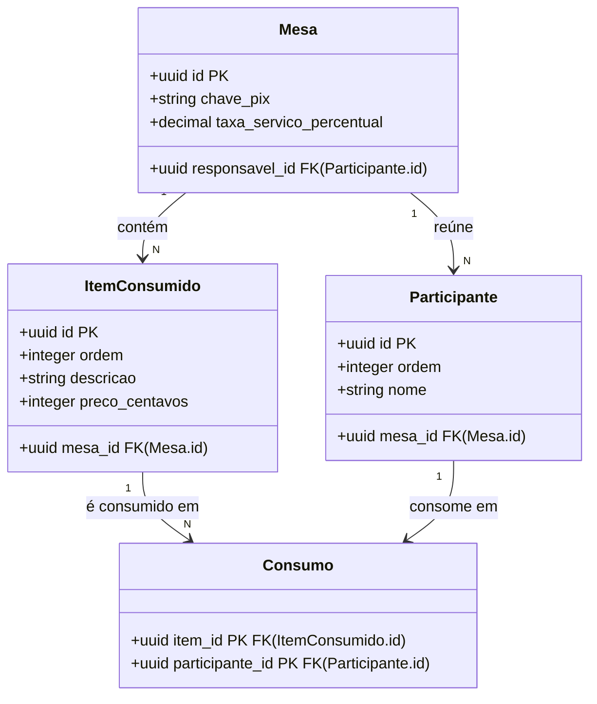

# Loop 2 · MER · rodada 01 — racha-conta

> Revise o modelo. Você pode editar o bloco mermaid abaixo antes de aprovar.
> Responda as perguntas, marque `[x]` em aprovar ou rejeitar e rode `idd fase0 loop2 racha-conta`.
> Aprovar grava modelo/dominio.mmd (Confirm-Once da etapa). Ao rejeitar, diga o porquê no comentário.

## Perguntas

### P01 · bloqueante

Em que ordem o rodízio do centavo indivisível percorre os participantes e os itens da mesa?

Por quê: A decisão D-002 fixou o rodízio ao longo de toda a mesa (o centavo extra vai para o próximo participante que ainda não recebeu nenhum), mas não diz quem é o 'próximo' nem em que ordem os itens são rateados. Sem uma ordem estável, o mesmo conjunto de itens pode gerar cotas diferentes, e o modelo precisa guardar essa ordem (atributo ordem em Participante e em ItemConsumido).

1. Ordem de entrada dos participantes na mesa e ordem de registro dos itens.
2. Ordem alfabética dos nomes dos participantes e ordem de registro dos itens.
3. Ordem definida pelo responsável da mesa para os participantes e ordem de registro dos itens.

**Resposta:** 2

### P02 · não-bloqueante

A taxa de serviço é sempre 10% ou pode ser ajustada em cada mesa?

Por quê: As fontes citam 10%, e o legado guarda taxa_servico_percentual por mesa com padrão 10. Se for fixa, ela é constante do aplicativo e sai do modelo; se for ajustável, é atributo da Mesa.

1. Ajustável por mesa, com 10% como padrão (atributo da Mesa).
2. Fixa em 10% para todas as mesas (constante, fora do modelo).

**Resposta:** 1

### P03 · não-bloqueante

O aplicativo deve registrar que um participante pagou a própria cota?

Por quê: A INT-004 permite pagar por Pix, mas nenhuma intenção diz se o aplicativo acompanha o pagamento. O legado tem os campos pago e comprovante_pix_url sem regra associada. Isso decide se existe um atributo ou uma classe de pagamento no modelo; por ora não modelei nenhum dos dois.

1. Não: o pagamento acontece fora do aplicativo.
2. Sim: o responsável da mesa marca a cota como paga.
3. Sim: o participante anexa o comprovante e o responsável confirma.

**Resposta:** 3

## Modelo proposto

### Diagnóstico do normalizador (calculado pelo IDD, não pela IA)

- ✓ **Mesa** · chaves {id} · BCNF
- ✓ **Participante** · chaves {id} {mesa_id, ordem} · BCNF
- ✓ **ItemConsumido** · chaves {id} {mesa_id, ordem} · BCNF
- ✓ **Consumo** · chaves {item_id, participante_id} · BCNF
- ⚠ classes fora do dicionário: Consumo

### Rastreio classe → termo

- **Mesa** ← Mesa — Termo aggregate. Guarda a chave Pix do responsável desde a criação (D-003, INT-005) e a taxa de serviço (TaxaServico, value-object, vira atributo; ver P02). responsavel_id realiza o papel ResponsavelMesa, que o dicionário define como um Participante.
- **Participante** ← Participante — Termo entity. ordem sustenta o rodízio do centavo (D-002; ver P01); (mesa_id, ordem) é chave candidata, declarada como DF.
- **ItemConsumido** ← ItemConsumido — Termo entity. Preço em centavos inteiros (definição do termo, INV-005). ordem fixa a sequência do rateio (P01).
- **Consumo** ← (sem termo) — Classe associativa N:M entre ItemConsumido e Participante: o 'conjunto de participantes que o consumiram' da definição de ItemConsumido. Ainda não há termo no dicionário; o alias 'Consumidor' pertence a Participante.

### Suposições do SHADA (confirme pelas perguntas)

- Cota não é armazenada: é sempre calculada a partir dos itens, dos consumos e da taxa (D-001 diz que o total de referência é o calculado). Isso elimina o valor_a_pagar derivado do legado.
- Nota não é armazenada: D-001 a reduz a conferência, sem papel em nenhuma invariante.
- O responsável da mesa é um Participante da própria mesa, como diz a definição de ResponsavelMesa; a criação da mesa e do participante responsável ocorre na mesma transação (a detalhar na etapa de casos de uso).
- Participante tem nome para que a cota seja exibida a cada um (INT-003); telefone e título da mesa do legado ficaram de fora por não aparecerem em nenhuma intenção.
- A taxa de serviço é ajustável por mesa (recomendação da P02).

## Decisão

**Modelo:** [ ] aprovar  [x] rejeitar

**Comentário (opcional):** refazer incorporando as respostas: rodízio em ordem alfabética dos participantes (P01) e pagamento com comprovante anexado pelo participante e confirmado pelo responsável (P03)

## Contradições

- O legado-schema.sql guarda valor_total_nota e compara a soma das cotas com ele; a D-001 fixou o total calculado como referência, então o modelo não tem esse atributo.
- O legado guarda valor_a_pagar por participante, um valor derivável; mantê-lo exigiria sincronizá-lo com itens e consumos a cada alteração.

## Observações

Rodada gerada pelo provedor manual: a resposta foi produzida pelo Claude Opus 5.5 na sessão do Claude Code em 2026-10-27, seguindo este pedido sem alterações. A INV-004 (consumidor e item da mesma mesa) não é expressável por dependência funcional sem pôr mesa_id em Consumo, o que criaria a dependência parcial item_id → mesa_id (viola a 2NF); ela fica para as transações de negócio da etapa de casos de uso. O ciclo de vida da mesa (estados ABERTA, EM_RATEIO, AGUARDANDO_PAGAMENTO e LIQUIDADA do legado) também fica para a etapa de estados. Se a classe Consumo for mantida, vale propor o termo no dicionário.
