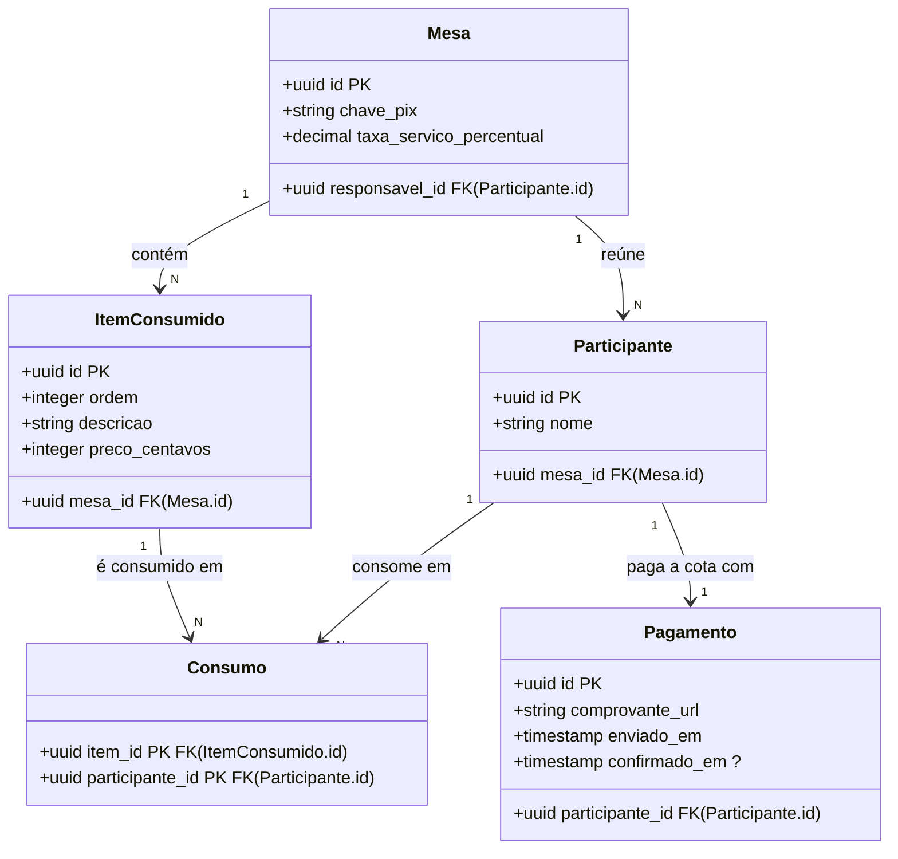

# Loop 2 · MER · rodada 02 — racha-conta

> Revise o modelo. Você pode editar o bloco mermaid abaixo antes de aprovar.
> Responda as perguntas, marque `[x]` em aprovar ou rejeitar e rode `idd fase0 loop2 racha-conta`.
> Aprovar grava modelo/dominio.mmd (Confirm-Once da etapa). Ao rejeitar, diga o porquê no comentário.

## Perguntas

### P01 · bloqueante

Se dois participantes da mesma mesa tiverem o mesmo nome, como fica a ordem alfabética do rodízio do centavo?

Por quê: A D-022 fixou a ordem alfabética dos nomes, mas dois nomes iguais (dois 'João') empatam, e o rodízio deixa de ser determinístico. A resposta decide se o nome é único na mesa (chave candidata {mesa_id, nome}) ou se é preciso um critério de desempate guardado no modelo.

1. O nome é único na mesa: o aplicativo não aceita dois participantes com o mesmo nome.
2. Nomes podem se repetir; o desempate é a ordem de entrada na mesa.

**Resposta:**

### P02 · bloqueante

Um participante pode enviar mais de um comprovante para a mesma cota?

Por quê: A D-024 diz que o participante anexa o comprovante e o responsável confirma, mas não diz o que acontece se o responsável não aceitar o comprovante, nem se a cota pode ser paga em partes. Isso decide se o Pagamento tem um registro por participante (participante_id é chave) ou vários.

1. Não: um único pagamento por participante; um comprovante novo substitui o anterior até a confirmação.
2. Sim: cada envio é um pagamento separado, e o responsável confirma ou recusa cada um.
3. Sim: a cota pode ser paga em partes, cada parte com o próprio comprovante.

**Resposta:**

### P03 · não-bloqueante

O pagamento deve guardar o valor pago ou vale sempre a cota calculada no momento da confirmação?

Por quê: A cota não é armazenada (é calculada). Se um item for incluído depois de um pagamento confirmado, a cota muda e o registro não mostra mais quanto foi pago. Guardar o valor resolve isso, mas cria uma regra nova (o que fazer com a diferença) que ainda não foi decidida.

1. Guardar o valor pago em centavos no pagamento.
2. Não guardar: a mesa não aceita mudanças nos itens depois do primeiro pagamento (a detalhar na etapa de estados).

**Resposta:**

## Modelo proposto

### Diagnóstico do normalizador (calculado pelo IDD, não pela IA)

- ✓ **Mesa** · chaves {id} · BCNF
- ✓ **Participante** · chaves {id} {mesa_id, nome} · BCNF
- ✓ **ItemConsumido** · chaves {id} {mesa_id, ordem} · BCNF
- ✓ **Consumo** · chaves {item_id, participante_id} · BCNF
- ✓ **Pagamento** · chaves {id} {participante_id} · BCNF
- ⚠ classes fora do dicionário: Consumo, Pagamento

### Rastreio classe → termo

- **Mesa** ← Mesa — Termo aggregate. chave_pix obrigatória desde a criação (D-003, INT-005); taxa_servico_percentual ajustável por mesa, padrão 10 (D-023); responsavel_id realiza o papel ResponsavelMesa.
- **Participante** ← Participante — Termo entity. O atributo ordem saiu: a D-022 fixou a ordem alfabética dos nomes. A DF {mesa_id, nome} → id supõe nome único na mesa (ver P01).
- **ItemConsumido** ← ItemConsumido — Termo entity. ordem guarda a ordem de registro dos itens, que a D-022 usa no rodízio.
- **Consumo** ← (sem termo) — Classe associativa N:M entre ItemConsumido e Participante; ainda sem termo no dicionário.
- **Pagamento** ← (sem termo) — Realiza a D-024: comprovante anexado pelo participante (comprovante_url, enviado_em) e confirmação do responsável (confirmado_em, vazio até confirmar). Ainda sem termo no dicionário; a DF participante_id → id supõe um pagamento por participante (ver P02).

### Suposições do SHADA (confirme pelas perguntas)

- Nome único na mesa (recomendação da P01): {mesa_id, nome} é chave candidata de Participante.
- Um pagamento por participante (recomendação da P02): participante_id é chave candidata de Pagamento.
- Só o responsável da mesa confirma pagamentos (D-024), então Pagamento não precisa guardar quem confirmou.
- O valor pago não é guardado até a resposta da P03.
- Cota e total da nota continuam não armazenados (D-001).

## Decisão

**Modelo:** [ ] aprovar  [ ] rejeitar

**Comentário (opcional):**

## Contradições

- O legado guarda pago e comprovante_pix_url no próprio participante; pela D-024 o pagamento tem envio e confirmação em momentos diferentes, o que pede datas próprias e, se a P02 admitir reenvios, uma classe separada.

## Observações

Rodada gerada pelo provedor manual: a resposta foi produzida pelo Claude Opus 5.5 na sessão do Claude Code em 2026-10-27, seguindo este pedido sem alterações. Mudanças em relação à MER-01 (rejeitada em D-025): Participante perdeu o atributo ordem e ganhou a chave candidata {mesa_id, nome}; entrou a classe Pagamento. Consumo e Pagamento ainda não têm termo no dicionário; convém propô-los ao autor (o Gate 2 só avisa). A INV-004 continua para as transações da etapa de casos de uso.
