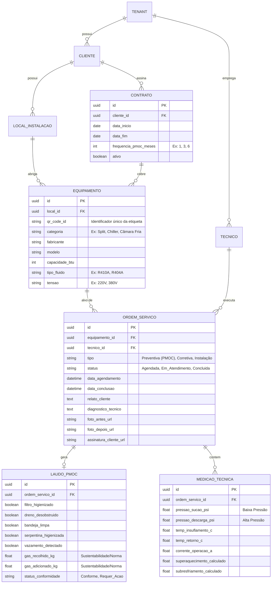

# Modelo Entidade-Relacionamento: IDD Refrigeração

Este diagrama lógico mapeia as entidades necessárias para suportar a operação técnica de manutenção, PMOC e corretivas, mantendo o histórico térmico e legal dos equipamentos.

