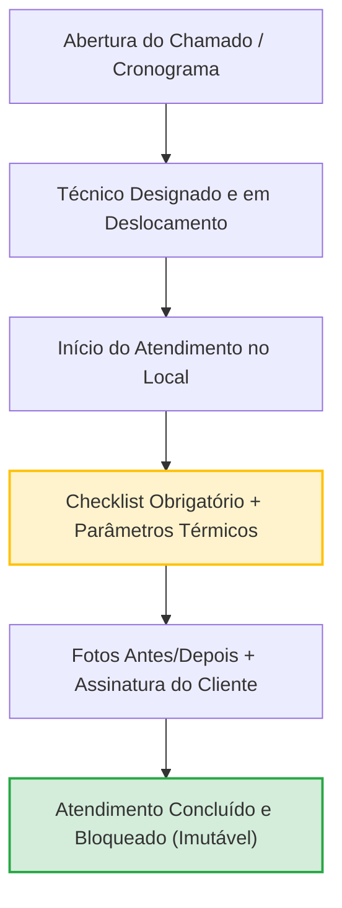

# Apresentação Estratégica de Domínio: Gestão de Manutenção em Refrigeração (HVAC-R)
*Documento de Alinhamento e Refinamento de Escopo com o Cliente*

---

## Slide 1: Visão Geral e Propósito da Apresentação

### Objetivo da Reunião
Alinhar em conjunto as **regras do negócio**, as **rotinas de campo** e as **exigências legais** da operação de refrigeração e climatização, estabelecendo com clareza o que a solução deve cobrir e quais regras não podem ser flexibilizadas.

### A Dor Central do Setor
Softwares genéricos de manutenção predial falham na refrigeração porque ignoram:
1. **O ciclo termodinâmico**: compressores trabalham sob pressões e temperaturas críticas; uma máquina não está consertada apenas porque "está ligando".
2. **Rigor Sanitário e Legal**: o **PMOC** (Lei Federal 13.589/2018) exige responsabilidade técnica habilitada e laudos com validade jurídica.
3. **Fluidos Refrigerantes e Meio Ambiente**: o gás não pode simplesmente "sumir"; vazamentos representam custo direto, desgaste do maquinário e infração ambiental.

---

## Slide 2: O Que a Solução Entrega (Intenções do Negócio)

As capacidades que a empresa terá na mão para controlar a operação de ponta a ponta:

### 1. Prontuário Digital do Maquinário (QR Code na Máquina)
- **Identificação Imediata**: O mecânico aponta o celular para a etiqueta da condensadora ou evaporadora e acessa todo o histórico de reparos, manutenções preventivas e peças trocadas.
- **Ficha Técnica Real**: Capacidade térmica (BTUs, TR ou HP), tensão de alimentação, fabricante, modelo e tipo de fluido refrigerante de fábrica.
- **Rastreamento de Trocas de Componentes**: Registro de vida útil de compressores, motores-ventiladores, placas inverter e serpentinas.

### 2. Gestão Automatizada do PMOC (Conformidade com a Lei)
- **Geração Automática do Calendário**: Cronograma automático com periodicidades mensais, trimestrais e semestrais.
- **Checklist Técnico Normativo**: Verificação obrigatória de limpeza de filtros, desobstrução de drenos, higienização com bactericida e estado das bandejas de condensado.
- **Laudo do Responsável Técnico**: Emissão de relatórios técnicos prontos para auditoria de órgãos fiscalizadores (Vigilância Sanitária e Ministério do Trabalho), vinculados ao Responsável Técnico (CREA/CFT).

### 3. Atendimento a Chamados e Emergências Térmicas
- **Triagem por Risco**: Diferenciação clara entre uma falha crítica (ex.: câmara fria de vacinas ou carnes descongelando) e um chamado de conforto térmico (ex.: split de escritório).
- **Despacho Direcionado**: Envio do chamado para o profissional qualificado para aquele tipo de máquina (ex.: especialista em Chillers/VRF vs. mecânico de refrigeração comercial).
- **Controle de Tempo de Resposta**: Medição do tempo desde a abertura da emergência até a chegada e o restabelecimento da temperatura ideal.

### 4. Rotina Técnica com Evidências de Campo
- **Parâmetros Físicos Registrados**: Leitura de pressões de trabalho (baixa e alta), temperaturas de insuflamento e retorno ($\Delta T$), e cálculo prático do rendimento térmico.
- **Registro Fotográfico Antes e Depois**: Fotos comprovando o estado da serpentina antes e após a higienização química.
- **Assinatura do Cliente na Tela**: Validação no local pelo responsável do estabelecimento ao encerrar o serviço.
- **Funcionamento em Locais Isolados**: O mecânico preenche todo o atendimento normalmente dentro de subsolos, casas de máquinas ou câmaras frigoríficas, sem necessidade de conexão no momento.

### 5. Controle de Fluidos Refrigerantes e Peças
- **Histórico de Recargas de Gás**: Quantidade exata em quilos ou gramas de fluido adicionado (R410A, R32, R134a, R404A, etc.).
- **Recolhimento Ecológico**: Registro da retirada de fluido contaminado ou para reparo com máquina recolhedora e direcionamento para destinação ecológica.
- **Estoque Móvel**: Controle dos materiais e peças que saem da viatura do técnico (capacitores, contatores, filtros secadores, sensores de temperatura).

---

## Slide 3: Regras Invioláveis do Negócio (Invariantes)

Condições absolutas que o sistema **jamais permitirá que sejam desrespeitadas**, blindando a empresa jurídica e operacionalmente:

1. **Nenhum Serviço Concluído Sem Evidência Real**:
   - Um atendimento não pode ser encerrado sem o preenchimento dos itens mínimos do checklist e sem a assinatura do cliente ou justificativa de recusa.
2. **Laudo Concluído é Intocável (Segurança Jurídica)**:
   - Após a conclusão e assinatura do cliente, os dados técnicos e apontamentos tornam-se definitivos. Qualquer alteração posterior exige a abertura de um atendimento de revisão ou termo de auditoria.
3. **Proibição de Datas Retroativas no PMOC**:
   - Manutenções preventivas vencidas realizadas com atraso serão registradas com a data exata da execução em campo, registrando o histórico real sem adulterações documentais.
4. **Obrigatoriedade de Responsável Técnico**:
   - Planos de PMOC para instalações com carga térmica superior a 60.000 BTU/h (5 TR) exigem a indicação formal de um Engenheiro ou Técnico com registro profissional ativo (CREA ou CFT).
5. **Consistência Termodinâmica Básica**:
   - O sistema valida a coerência dos dados informados: a pressão de descarga (alta) deve ser superior à pressão de sucção (baixa), e nenhuma recarga de fluido pode ser registrada com valores negativos ou zerados.
6. **Vínculo Físico Garantido**:
   - Toda máquina cadastrada pertence obrigatoriamente a um cliente e a um local físico determinado (endereço, pavimento, sala).

---

## Slide 4: Dimensionamento de Escopo — Cenário Proposto vs. Cenário Alternativo

Para tomarmos a melhor decisão estratégica de investimento, prazo e complexidade de adoção pela equipe técnica, estruturamos dois caminhos:

### Cenário 1: Contexto Proposto (Solução Integral de Excelência)
*Foco: Empresas com contratos corporativos, frotas técnicas estruturadas, exigência de laudos complexos e múltiplos clientes com PMOC.*

- **Escopo Completo**:
  - Cadastro hierárquico total (Cliente -> Filial -> Setor -> Máquina -> Componentes).
  - Emissão completa de PMOC com geração de laudo técnico em PDF padronizado com logo e dados do CREA/CFT.
  - Medições termodinâmicas completas (pressão, temperatura, cálculo assistido de superaquecimento e sub-resfriamento).
  - Rastreabilidade detalhada de botijas de fluido refrigerante e protocolo ambiental de vazamentos.
  - Gestão de estoque da oficina e estoque móvel das viaturas dos técnicos.
  - Portal do cliente contratante para abertura de chamados e consulta de certificados do PMOC.
  - Operação de campo em locais sem conexão de dados (sincronização automática).

### Cenário 2: Contexto Alternativo (Escopo Essencial / Implantação Rápida)
*Foco: Início ágil, redução drástica de tempo de treinamento dos mecânicos e resolução imediata do gargalo de papel e ordens de serviço perdidas.*

- **Escopo Essencial**:
  - Cadastro simplificado de equipamentos com identificação por QR Code.
  - Abertura, agendamento e despacho de Ordens de Serviço (Preventivas e Corretivas).
  - Checklist digital de rotina (Limpeza de filtro, teste elétrico básico, estado geral).
  - Registro de fotos (antes e depois) e assinatura digital do cliente na tela do celular.
  - Registro simplificado de peças utilizadas e fluido refrigerante adicionado.
  - Emissão de Laudo Simples de Atendimento em PDF enviado diretamente ao cliente por WhatsApp ou e-mail.
- **O que fica para a Fase Posterior**:
  - Cálculos avançados de superaquecimento e sub-resfriamento integrados.
  - Controle individualizado por número de série de botijas de gás e logística reversa de recolhimento.
  - Portal de autoatendimento exclusivo para o cliente final.
  - Controle detalhado de estoque de almoxarifado entre veículos.

---

## Slide 5: Quadro Comparativo de Decisão

| Critério de Comparação | Cenário 1: Solução Proposta (Completa) | Cenário 2: Escopo Alternativo (Essencial) |
| :--- | :--- | :--- |
| **Tempo para Colocar em Produção** | 6 a 10 semanas | 3 a 4 semanas |
| **Curva de Aprendizado dos Mecânicos** | Média (exige familiaridade com medições termodinâmicas no app) | Baixa (fluxo direto de fotos, checklist e assinatura) |
| **Conformidade com PMOC** | Totalmente automatizada com laudo de engenharia | Atendida através de checklist preventivo estruturado |
| **Controle de Vazamentos de Gás** | Milimétrico (balanço de massa por botija e histórico de vazamento) | Registro operacional (quantidade aplicada no serviço) |
| **Complexidade Operacional** | Alta precisão e controle corporativo | Foco em agilidade, produtividade e fim do papel |
| **Investimento Inicial** | Médio / Alto | Reduzido / Faseado |

---

## Slide 6: Roteiro de Perguntas para o Refinamento

Para fecharmos a especificação definitiva, precisamos que o cliente responda a estas 4 questões práticas:

1. **Perfil do Maquinário Atendido**:
   - Qual a maior concentração dos atendimentos: aparelhos compactos (Split Hi-Wall, Cassete, Piso-Teto) ou sistemas de grande porte (VRF, Chillers, Câmaras Frigoríficas industriais)?
2. **Instrumentação das Equipes de Campo**:
   - Os técnicos utilizam ferramentas digitais (manômetros digitais/vacuômetros bluetooth) ou manômetros analógicos tradicionais (manifolds de ponteiro)?
3. **Rotina com o Fluido Refrigerante**:
   - A empresa costuma recolher fluido para regeneração em oficina ou o foco atual é identificar vazamentos e efetuar a recarga na máquina?
4. **Responsabilidade Técnica Atual**:
   - A empresa já possui engenheiro mecânico ou técnico em refrigeração próprio emitindo ART/TRT, ou os laudos são gerados por parceiros externos?
