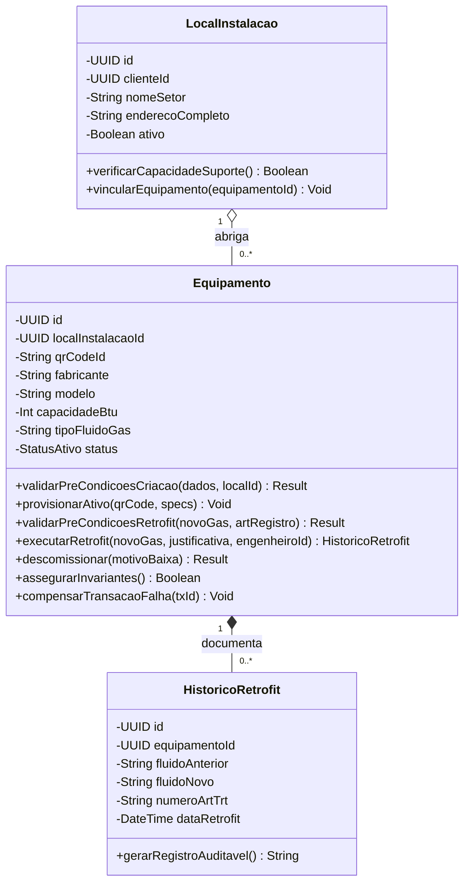
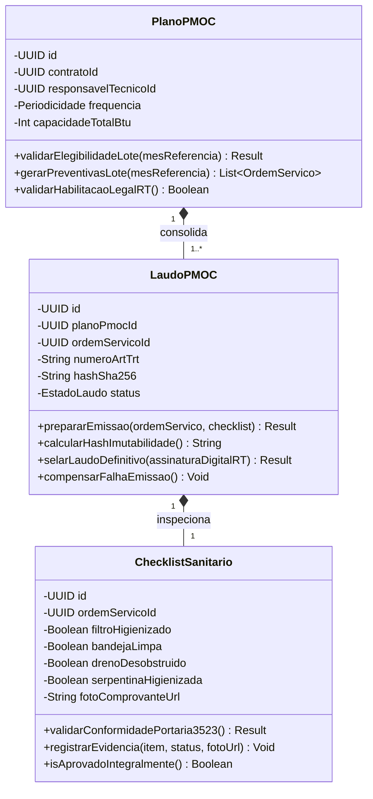
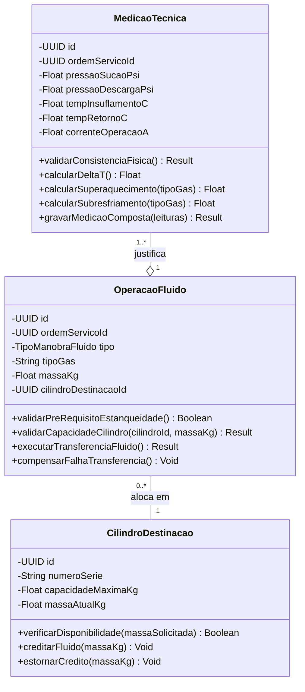
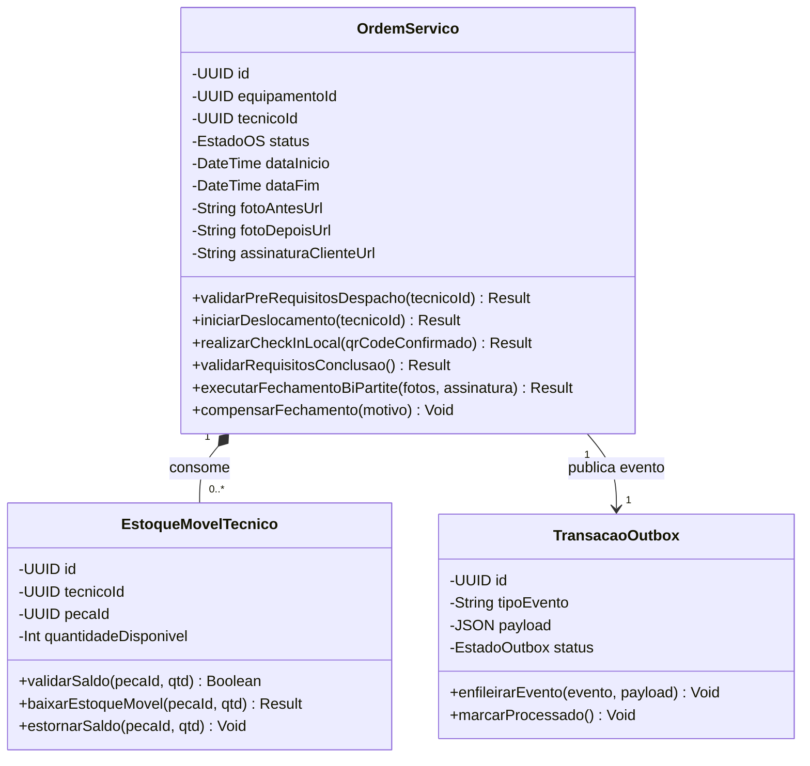

# Especificação Técnica IDD: Bounded Contexts Rígidos, Casos de Uso Transacionais & Atomicidade

> **Paradigma Intent-Driven Development (IDD) — Engenharia de Domínio HVAC-R**  
> **Tema:** Desafios Práticos e Como o IDD Deve Operá-los — Item 1: Bounded Contexts Rígidos (Modularidade)  
> **Autor:** Eliézer Rosa & IA Pair Programmer  
> **Data:** Outubro de 2026  

---

## 1. Visão Geral: O Problema da Modularidade no IDD

No desenvolvimento assistido por IA e no desenvolvimento ágil convencional, um dos maiores riscos é a criação de **"código espaguete semântico"**: a IA, ao implementar regras de negócio em linguagem natural, tende a misturar responsabilidades se não houver **fronteiras de contexto rígidas (Bounded Contexts)**.

No Paradigma IDD, a modularidade não é apenas uma recomendação de estilo; ela é uma **invariante arquitetural**:
1. **Casos de Uso de 1º Nível (Intenções Macro)** definem os limites do Bounded Context.
2. **Casos de Uso de 2º Nível (Operações Transacionais)** representam **Transações Atômicas de Negócio** (*Unit of Work / Aggregate Root Boundary Transaction / Two-Phase Commit*).
3. **Invariantes Profundas de Negócio (MER + Física + Regulatória)** garantem que nenhuma transação comite estado corrompido ou viole as relações do banco de dados.
4. **Classes UML com Métodos Comportamentais Estritos** implementam o protocolo de transação em 4 etapas (*Guarda / Mutação / Pós-Condição / Compensação*), garantindo atomicidade total sem dependência exclusiva de locks de banco de dados.

```
┌────────────────────────────────────────────────────────────────────────┐
│ CASO DE USO DE 1º NÍVEL (Intenção Macro do Bounded Context)            │
└───────────────────────────────────┬────────────────────────────────────┘
                                    │ decompõe-se em
                                    ▼
┌────────────────────────────────────────────────────────────────────────┐
│ CASOS DE USO DE 2º NÍVEL (Transações Atômicas / Unit of Work)          │
│ • Executam protocolo Two-Phase Commit / Aggregate Boundary             │
│ • Garantem ACID de negócio (Tudo ou Nada)                              │
└───────────────────────────────────┬────────────────────────────────────┘
                                    │ governa e valida
                                    ▼
┌────────────────────────────────────────────────────────────────────────┐
│ INVARIANTES PROFUNDAS DO DOMÍNIO (Preservação MER + Regras Físicas)    │
│ • Integridade Referencial & Limites de Cardinalidade                   │
│ • Invariantes Termodinâmicas (Pressão Descarga > Pressão Sucção)       │
│ • Invariantes Sanitárias (Portaria 3.523 e Lei 13.589/18)              │
└───────────────────────────────────┬────────────────────────────────────┘
                                    │ implementada através de
                                    ▼
┌────────────────────────────────────────────────────────────────────────┐
│ MÉTODOS COMPORTAMENTAIS NAS CLASSES UML (Sub-componentes Atômicos)     │
│ 1. validarPreCondicoes()  ──► 2. executarMutacao()                     │
│ 3. assegurarInvariantes() ──► 4. compensarRollback()                   │
└────────────────────────────────────────────────────────────────────────┘
```

---

## 2. Mapa dos 4 Bounded Contexts Desacoplados

A partir do domínio de Refrigeração Comercial/Industrial (HVAC-R), identificamos 4 sub-módulos rigorosamente isolados:

| Sub-Módulo / Bounded Context | Responsabilidade Central | UC de 1º Nível | Atores Primários |
| :--- | :--- | :--- | :--- |
| **BC1: Ativos & Prontuário Técnico** | Gestão de identidade, placa, histórico e retrofits dos equipamentos. | **UC-1.0: Gestão do Parque de Máquinas e Prontuário** | Gestor Técnico, Fabricante, Fiscal |
| **BC2: PMOC & Compliance Sanitário** | Planejamento, execução normativa e emissão de laudos com ART/TRT. | **UC-2.0: Governança do PMOC e Conformidade Legal** | Resp. Técnico (CREA/CFT), Mecânico, Anvisa |
| **BC3: Física Térmica & Fluidos** | Diagnóstico manométrico, balanço de gás e conformidade CONAMA. | **UC-3.0: Manobras Termodinâmicas e Fluido Refrigerante** | Mecânico Especialista, Auditor Ambiental |
| **BC4: Field Service & Operação** | Despacho, roteirização, consumo de peças e fechamento bi-partite. | **UC-4.0: Execução de Ordens de Serviço em Campo** | Mecânico em Campo, Cliente/Síndico, Z-API |

---

## 3. Decomposição Detalhada: UCs de 2º Nível, Invariantes & Métodos UML

---

### 3.1 Bounded Context 1: Gestão de Ativos & Prontuário Técnico Digital

#### UC de 1º Nível: `UC-1.0 — Gestão do Parque de Máquinas e Prontuário`
Governa a existência legal, física e técnica do maquinário nas filiais do cliente.

#### UCs de 2º Nível (Transações Atômicas):
1. **`UC-1.1-TX` Provisionar Ativo com QR Code e Ficha de Fábrica**
   - *Natureza Transacional:* Operação atômica de criação de identidade física. Criação do registro em `EQUIPAMENTO` vinculada obrigatoriamente a um `LOCAL_INSTALACAO` validado e geração de hash de tag física.
2. **`UC-1.2-TX` Executar Retrofit Crítico de Fluido Refrigerante e Compressor**
   - *Natureza Transacional:* Transação de mutação com dupla validação (engenharia e ambiental). Atualiza a especificação de fluido da máquina, arquiva a especificação original em `HISTORICO_RETROFIT` e anexa a ART/TRT do engenheiro.
3. **`UC-1.3-TX` Descomissionar / Baixar Ativo com Preservação Histórica**
   - *Natureza Transacional:* Fechamento de ciclo de vida. Impede exclusão física (`DELETE`), forçando status `DESCOMISSIONADO` e congelando o prontuário como somente-leitura.

#### Invariantes Profundas de Negócio (MER & Regras):
- **INV-BC1-01 (Unicidade Global de Tag):** `UNIQUE(qr_code_id)` — Impossibilidade matemática de dois equipamentos dividirem a mesma tag física.
- **INV-BC1-02 (Proibição de Equipamento Órfão):** `NOT NULL(local_instalacao_id)` e `EXISTS(LOCAL_INSTALACAO WHERE status = 'ATIVO')`. O equipamento não pode existir sem endereço físico e vínculo com o contrato do cliente.
- **INV-BC1-03 (Imutabilidade de Placa sem Retrofit):** Os atributos `capacidade_btu`, `tensao_nominal` e `tipo_fluido_original` são imutáveis via update direto. Toda alteração exige abertura de `UC-1.2-TX` com aprovação de ART/TRT.
- **INV-BC1-04 (Compatibilidade de Óleo/Gás):** Na troca de fluido (ex: R-22 para R-407C ou R-410A para R-32), o sistema rejeita a transação se o lubrificante (Mineral vs Sintético POE/PVE) for incompatível.

#### Classes UML e Métodos de Atomicidade:



- **Protocolo de Atomicidade em `UC-1.2-TX (Retrofit)`:**
  1. `Equipamento.validarPreCondicoesRetrofit(novoGas, artRegistro)`: valida se equipamento está ativo e se o novo gás é termodinamicamente suportado pelo trocador.
  2. `HistoricoRetrofit.gerarRegistroAuditavel()`: cria o registro de auditoria antes da mutação.
  3. `Equipamento.executarRetrofit(...)`: aplica a troca de fluido e vincula a FK de auditoria.
  4. `Equipamento.assegurarInvariantes()`: valida que o histórico foi gravado e que o status não foi violado. Em caso de falha, dispara `compensarTransacaoFalha(txId)` restaurando o gás anterior.

---

### 3.2 Bounded Context 2: PMOC Normativo & Governança Sanitária

#### UC de 1º Nível: `UC-2.0 — Governança do PMOC e Conformidade Legal`
Garante a conformidade da empresa e dos clientes com a **Lei Federal 13.589/2018** e **Portaria MS 3.523/1998**.

#### UCs de 2º Nível (Transações Atômicas):
1. **`UC-2.1-TX` Gerar Lote Periódico de Preventivas PMOC (Cron Mensal)**
   - *Natureza Transacional:* Operação em lote idempotente. Gera as ordens de serviço mensais de cada ativo sob contrato ativo, sem duplicar chamados no mesmo ciclo mensal.
2. **`UC-2.2-TX` Executar e Consolidar Checklist Sanitário Obrigatório**
   - *Natureza Transacional:* Validação de pré-requisitos normativos. Coleta a inspeção dos 4 subsistemas (filtros, bandejas, dreno, serpentina), exigindo evidências fotográficas para não conformidades.
3. **`UC-2.3-TX` Selar Laudo PMOC com Assinatura Digital e Hash Criptográfico**
   - *Natureza Transacional:* Two-Phase Commit de auditoria. Consolida todas as ordens de serviço do ciclo, valida a habilitação do Responsável Técnico no CREA/CFT, emite o laudo em PDF e grava o hash SHA-256 no banco tornando-o estritamente somente-leitura.

#### Invariantes Profundas de Negócio (MER & Regras):
- **INV-BC2-01 (Quarteto Sanitário Indispensável):** O laudo rejeita fechamento se qualquer um dos quatro itens normativos for nulo:
  $$\text{ChecklistSanitario} = \{ \text{filtro\_ok}, \text{bandeja\_ok}, \text{dreno\_ok}, \text{serpentina\_ok} \} \neq \text{NULL}$$
- **INV-BC2-02 (Obrigatoriedade de RT Habilitado):** Para qualquer parque térmico com somatório superior a 60.000 BTU/h (5 TR), o laudo não comita sem um `responsavel_tecnico_id` com `registro_conselho_valido == true`.
- **INV-BC2-03 (Proibição Absoluta de Retroatividade Falsa):** É proibido retroagir a data de execução de uma preventiva atrasada. Se executada fora do mês de competência, o campo `status_execucao` deve ser gravado atomicamente como `CONCLUIDA_COM_ATRASO`.
- **INV-BC2-04 (Imutabilidade Criptográfica pós-Assinatura):** Uma vez gravado o `hash_sha256`, qualquer alteração no banco gera divergência de hash, invalidando o laudo perante auditoria judicial ou da Anvisa.

#### Classes UML e Métodos de Atomicidade:



- **Protocolo de Atomicidade em `UC-2.3-TX (Selar Laudo)`:**
  1. `LaudoPMOC.prepararEmissao(os, checklist)`: testa se o checklist possui aprovação integral (`isAprovadoIntegralmente() == true`) e se o RT está ativo.
  2. `LaudoPMOC.calcularHashImutabilidade()`: gera a assinatura canônica do payload (dados da OS + checklist + medições + RT).
  3. `LaudoPMOC.selarLaudoDefinitivo(...)`: altera o status para `ASSINADO_E_CONCLUIDO` e grava o hash em transação de banco única. Se qualquer etapa falhar, `compensarFalhaEmissao()` cancela a geração do PDF e mantém o rascunho auditável.

---

### 3.3 Bounded Context 3: Física Térmica, Fluidos Regulamentados & Ciclo Frigorífico

#### UC de 1º Nível: `UC-3.0 — Manobras Termodinâmicas e Fluido Refrigerante`
Controla os ciclos de compressão a vapor, manômetros, cálculos de rendimento e compliance com normas ambientais (**CONAMA / Protocolo de Montreal**).

#### UCs de 2º Nível (Transações Atômicas):
1. **`UC-3.1-TX` Registrar Medição Termodinâmica e Cálculo de Rendimento**
   - *Natureza Transacional:* Inserção atômica com cálculo em tempo de execução. Captura pressões de alta/baixa, temperaturas e calcula instantaneamente o Delta T, Superaquecimento e Sub-resfriamento.
2. **`UC-3.2-TX` Executar Carga/Recarga de Fluido com Teste de Estanqueidade Prévio**
   - *Natureza Transacional:* Transação de 2 fases condicionada a teste físico. A recarga de gás só é comitada se o teste de pressão de nitrogênio comprovar estanqueidade (zero vazamento).
3. **`UC-3.3-TX` Recolhimento Ecológico de Fluido com Destinação em Cilindro**
   - *Natureza Transacional:* Movimentação de estoque de resíduo perigoso. Debita gás da máquina e credita no cilindro de recolhimento, gerando etiqueta de rastreio para regeneração/descarte ecológico.

#### Invariantes Profundas de Negócio (MER & Física):
- **INV-BC3-01 (Invariante Termodinâmica Fundamental):** Em compressores mecânicos de vapor em operação:
  $$\text{Pressão de Descarga (Alta)} > \text{Pressão de Sucção (Baixa)}$$
  O banco de dados rejeita via `CHECK CONSTRAINT` qualquer leitura invertida.
- **INV-BC3-02 (Superaquecimento Útil Positivo):** O superaquecimento útil ($\Delta T_{sh} = T_{\text{sucção}} - T_{\text{evaporação}}$) não pode ser negativo em regime estável:
  $$\Delta T_{sh} \ge 0 \text{ K}$$
  Um valor negativo indica retorno de líquido para o compressor (risco iminente de quebra de biela/válvula).
- **INV-BC3-03 (Precedência Obrigatória de Estanqueidade):** Uma recarga de fluido decorrente de chamado de vazamento exige `teste_estanqueidade_id` aprovado com `pressao_teste_psi \ge 150` por no mínimo 15 minutos sem queda manométrica.
- **INV-BC3-04 (Balanço de Massa do Cilindro de Recolhimento):** Todo recolhimento deve garantir:
  $$\text{massa\_recolhida} + \text{tara\_cilindro} \le \text{capacidade\_maxima\_cilindro}$$

#### Classes UML e Métodos de Atomicidade:



- **Protocolo de Atomicidade em `UC-3.2-TX (Recarga com Estanqueidade)`:**
  1. `OperacaoFluido.validarPreRequisitoEstanqueidade()`: consulta o laudo de teste de pressão prévio; se reprovado, lança `InvarianteViolationException("Proibida recarga sem teste de estanqueidade comprovado")`.
  2. `OperacaoFluido.executarTransferenciaFluido()`: registra a massa de gás injetada e decrementa a botija de serviço do mecânico.
  3. `MedicaoTecnica.validarConsistenciaFisica()`: verifica se após a recarga as pressões de trabalho se reestabeleceram. Se houver falha de rede ou queda de conexão, `compensarFalhaTransferencia()` desfaz a baixa de inventário.

---

### 3.4 Bounded Context 4: Field Service & Orquestração Operacional

#### UC de 1º Nível: `UC-4.0 — Execução de Ordens de Serviço em Campo`
Orquestra o ciclo de vida da prestação de serviços: despacho inteligente de técnicos, navegação, execução offline-first, consumo de componentes em estoque móvel e fechamento com entrega multicanal (WhatsApp).

#### UCs de 2º Nível (Transações Atômicas):
1. **`UC-4.1-TX` Despachar e Aceitar Ordem de Serviço com Bloqueio de Concorrência**
   - *Natureza Transacional:* Reserva atômica de recurso humano. Transiciona a OS de `AGENDADA` para `EM_DESLOCAMENTO`, impedindo que dois técnicos assumam a mesma máquina simultaneamente (*Pessimistic Locking / Optimistic Version Check*).
2. **`UC-4.2-TX` Consumir Componente do Estoque Móvel do Técnico**
   - *Natureza Transacional:* Baixa atômica de inventário móvel. Debita peças (capacitores, relés, filtros secadores) do carro daquele técnico e adiciona o item ao custo da OS com precisão contábil.
3. **`UC-4.3-TX` Fechamento Bi-Partite da OS com Notificação Instantânea (2PC & Outbox)**
   - *Natureza Transacional:* Transação distribuída clássica. Valida fotos (Antes/Depois), coleta assinatura do cliente na tela, transiciona a OS para `CONCLUIDA`, debita custos e grava evento na tabela `OUTBOX` para envio via API do WhatsApp em menos de 90 segundos.

#### Invariantes Profundas de Negócio (MER & Regras):
- **INV-BC4-01 (Transição Estrita de Máquina de Estados):**
  $$\text{RASCUNHO} \rightarrow \text{AGENDADA} \rightarrow \text{EM\_DESLOCAMENTO} \rightarrow \text{EM\_ATENDIMENTO} \rightarrow \text{CONCLUIDA}$$
  É impossível transicionar diretamente de `AGENDADA` para `CONCLUIDA` sem passar por `EM_ATENDIMENTO`.
- **INV-BC4-02 (Evidência Bi-Partite Obrigatória):**
  $$\text{Fechamento Valido} \iff (\text{foto\_antes\_url} \neq \emptyset) \land (\text{foto\_depois\_url} \neq \emptyset) \land (\text{assinatura\_cliente\_url} \neq \emptyset)$$
- **INV-BC4-03 (Saldo Positivo em Estoque Móvel):** Uma peça não pode ter baixa com saldo negativo no veículo do mecânico:
  $$\text{saldo\_estoque\_veiculo} - \text{quantidade\_aplicada} \ge 0$$
- **INV-BC4-04 (Garantia de Entrega Notificação — Outbox Pattern):** A mensagem para o WhatsApp do cliente não pode ser enviada por chamada HTTP solta no meio da transação de banco. Ela deve ser persistida atomicamente na tabela de `OUTBOX` dentro da mesma transação de commit da OS, garantindo entrega resiliente por worker.

#### Classes UML e Métodos de Atomicidade:



- **Protocolo de Atomicidade em `UC-4.3-TX (Fechamento Bi-Partite & Outbox)`:**
  1. `OrdemServico.validarRequisitosConclusao()`: valida se existem fotos de Antes e Depois e se medições foram preenchidas.
  2. `EstoqueMovelTecnico.baixarEstoqueMovel(...)`: realiza o débito atômico das peças usadas.
  3. `OrdemServico.executarFechamentoBiPartite(...)`: grava as URLs das fotos e a assinatura capturada no PWA.
  4. `TransacaoOutbox.enfileirarEvento("OS_CONCLUIDA", payload)`: grava o evento de disparo para a Z-API na mesma transação de banco de dados.
  5. Se o banco falhar ou a validação de assinatura falhar, ocorre **Rollback Total**: a OS permanece `EM_ATENDIMENTO`, as peças retornam ao estoque móvel via `estornarSaldo()` e nenhum WhatsApp é enviado.

---

## 4. O Padrão Canônico da Transação Atômica no IDD

No paradigma IDD, a atomicidade é garantida pela orquestração de **4 sub-componentes funcionais-comportamentais**:

```
 ┌─────────────────────────────────────────────────────────────┐
 │ FASE 1: GUARD & PRE-CONDITIONS                              │
 │ Chamada a validarPreCondicoes() em todas as classes         │
 │ • Se qualquer pré-condição falhar: REJEITA sem efeitos      │
 └──────────────────────────────┬──────────────────────────────┘
                                │ sucesso
                                ▼
 ┌─────────────────────────────────────────────────────────────┐
 │ FASE 2: MUTATE STATE                                        │
 │ Chamada a executarMutacao() em memória / Aggregate Root     │
 │ • Atualiza propriedades internas com isolamento             │
 └──────────────────────────────┬──────────────────────────────┘
                                │ sucesso
                                ▼
 ┌─────────────────────────────────────────────────────────────┐
 │ FASE 3: INVARIANT VERIFICATION & COMMIT                     │
 │ Chamada a assegurarInvariantes() pós-mutação                │
 │ • Executa validações cruzadas MER + regras físicas          │
 │ • Dispara Commit atômico no repositório de persistência     │
 └──────────────────────────────┬──────────────────────────────┘
                                │ em caso de exceção
                                ▼
 ┌─────────────────────────────────────────────────────────────┐
 │ FASE 4: COMPENSATE & ROLLBACK                               │
 │ Chamada a compensarRollback() em caso de qualquer falha     │
 │ • Restaura estado limpo anterior sem efeitos colaterais     │
 └─────────────────────────────────────────────────────────────┘
```

---

## 5. Roteiro e Estrutura Editorial para a Série de Vídeos de Apresentação

Esta especificação dá origem a 2 episódios estratégicos complementares para a playlist técnica do IDD:

### Episódio 1: *A Anatomia da Modularidade — Do Use Case de 1º Nível aos Bounded Contexts*
- **Abertura:** Por que projetos com IA falham quando o contexto é amplo demais (Alucinações e Acoplamento Oculto).
- **Cena 1:** Apresentação dos 4 Bounded Contexts HVAC-R e como os UCs de 1º nível definem fronteiras de propriedade.
- **Cena 2:** Decomposição dos UCs de 1º nível em UCs de 2º nível transacionais.
- **Cena 3:** Como o MER e o modelo de dados sustentam as fronteiras semânticas de cada módulo.

### Episódio 2: *Atomicidade na Prática — Two-Phase Commit, Invariantes Profundas & Métodos UML*
- **Abertura:** O que significa "Transação Atômica de Negócio" fora do banco de dados (Unit of Work e Sagas).
- **Cena 1:** O ciclo de 4 fases (Guarda, Mutação, Pós-condição, Compensação).
- **Cena 2:** Estudo de Caso Real: Conclusão de OS com checklist PMOC, baixa de peças e envio de WhatsApp sem inconsistência.
- **Cena 3:** O Diagrama de Classes UML com os 3 compartimentos exibindo os métodos comportamentais exatos de atomicidade.
