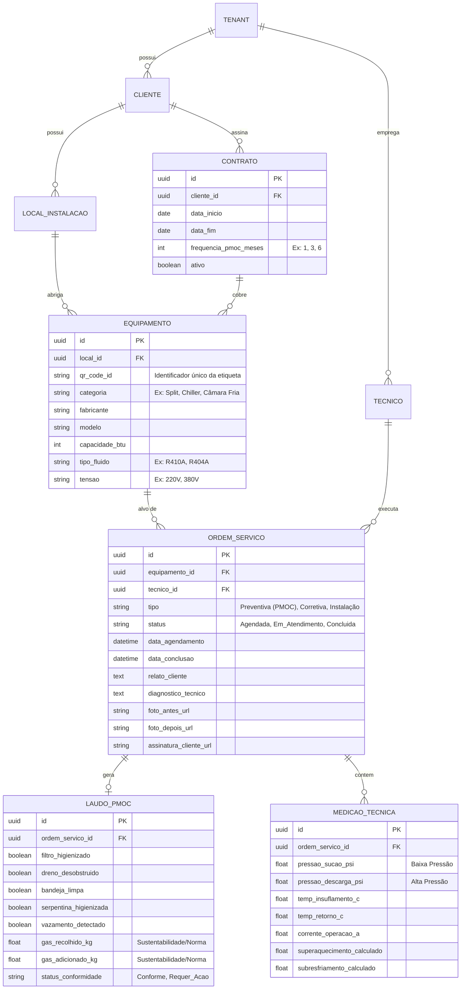
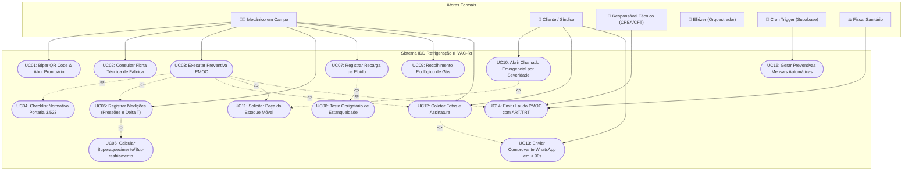
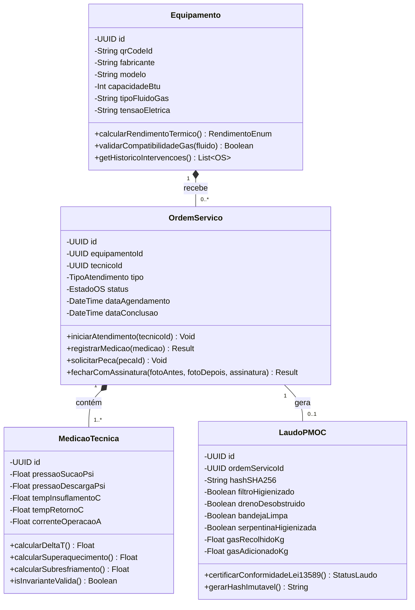
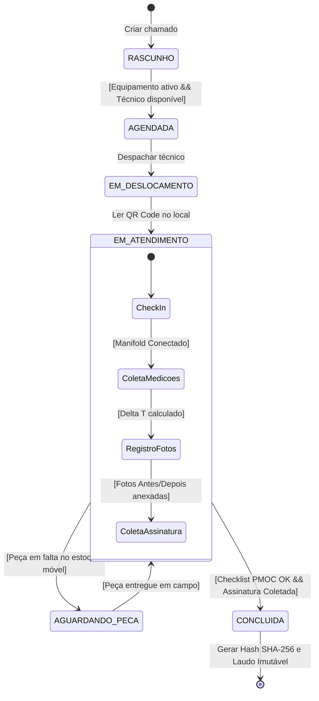

# Especificação de Domínio: Gestão de Manutenção em Refrigeração (HVAC-R)

## 1. Visão Geral do Domínio

O setor de **HVAC-R (Aquecimento, Ventilação, Ar Condicionado e Refrigeração Comercial/Industrial)** possui particularidades críticas que diferem da manutenção predial comum:
- Equipamentos termodinâmicos com circuitos pressurizados e fluidos refrigerantes regulamentados.
- Exigências legais e sanitárias rigorosas (como o **PMOC - Plano de Manutenção, Operação e Controle**, Lei Federal 13.589/2018 no Brasil).
- Parâmetros técnicos instrumentados (superaquecimento, sub-resfriamento, pressão de sucção/descarga, corrente elétrica, delta T térmico).
- Impacto financeiro imediato em caso de parada (ex.: perda de perecíveis em câmaras frigoríficas ou paralisação de data centers/climatização crítica).

---

## 2. Intenções do Negócio (Capabilities & Casos de Uso)

As intenções representam as capacidades e objetivos funcionais que o sistema deve suportar.

### 2.1 Gestão de Ativos e Equipamentos
- **Identificação Unívoca em Campo**: Identificar cada máquina via QR Code / NFC na etiqueta do equipamento.
- **Hierarquia de Instalações**: Organizar ativos por Cliente -> Contrato -> Unidade/Filial -> Setor/Sala -> Equipamento -> Componentes (Compressor, Evaporador, Condensador).
- **Ficha Técnica e Histórico Vitalício**: Manter dados de placa (modelo, número de série, fabricante, capacidade em BTUs/TR/HP, tipo de gás de fábrica, tensão/fase) e o histórico de todas as intervenções ocorridas.

### 2.2 Gestão de Planos Preventivos & PMOC
- **Cronograma Periódico Automatizado**: Gerar ordens de serviço preventivas automáticas com frequências configuráveis (semanal, mensal, trimestral, semestral, anual).
- **Checklists Normativos**: Executar rotinas específicas de higienização de filtros, verificação de dreno, bandejas, serpentinas e qualidade do ar.
- **Responsabilidade Técnica (RT)**: Vincular laudos a responsáveis técnicos habilitados (CFT/CREA) com emissão de ART/TRT e relatórios legais em PDF.

### 2.3 Gestão de Manutenção Corretiva e Atendimento Emergencial
- **Abertura Ágil de Chamados**: Registro pelo cliente ou central de suporte, categorizando urgência e severidade (ex: câmara fria descongelando vs split de recepção com baixo rendimento).
- **Despacho Inteligente & Roteirização**: Atribuição da OS ao técnico com base em competência técnica (ex: técnico especialista em VRF/Chiller vs mecânico de refrigeração comercial), localização e disponibilidade.
- **Controle de SLA**: Monitoramento de tempo de resposta (tempo até chegada) e tempo de solução (tempo até restabelecimento térmico).

### 2.4 Operação em Campo & Laudos Técnicos
- **Medições Termodinâmicas e Elétricas**:
  - Parâmetros elétricos: Tensão (V), Corrente de operação (A), Resistência de isolamento do compressor.
  - Parâmetros térmicos: Temperatura de insuflamento e retorno (Delta T), Temperatura ambiente.
  - Parâmetros de ciclo frigorífico: Pressão de sucção (baixa) e descarga (alta), cálculo de Superaquecimento Útil/Total e Sub-resfriamento.
- **Evidências Digitais**: Registro fotográfico obrigatório (Antes/Depois) e assinatura digital do cliente na tela do celular/tablet.
- **Modo Offline-First**: Capacidade de preencher OS e checklist em subsolos, casas de máquinas ou câmaras frigoríficas sem conectividade de internet.

### 2.5 Rastreabilidade de Fluidos Refrigerantes e Peças
- **Controle de Gás e Sustentabilidade (CONAMA / Protocolo de Montreal)**:
  - Registro de carga/reposição de gás (em gramas/kg e tipo: R410A, R32, R134a, R404A, etc.).
  - Registro de recolhimento de fluido (indicação de recolhedora, cilindro de destinação e envio para regeneração/descarte ecológico).
  - Detecção e registro de causa raiz de vazamento.
- **Controle de Insumos e Peças**: Baixa automática de peças do estoque móvel (carro do técnico) ou almoxarifado (capacitores, contatores, filtros secadores, válvulas de expansão, sensores).

### 2.6 Financeiro e Contratos
- **Faturamento Recorrente**: Cobrança por contrato mensal com escopo de manutenções preventivas inclusas e limites de chamados corretivos.
- **Orçamentos para Manutenção de Reparo**: Transição transparente de diagnóstico -> orçamento de peças e mão de obra -> aprovação pelo cliente -> execução.

---

## 3. Invariantes do Domínio (Regras de Negócio Rígidas)

Invariantes são condições e restrições que o sistema **NUNCA** pode permitir que sejam violadas, garantindo a integridade dos dados e a conformidade legal.

### 3.1 Invariantes de Equipamento e Ativo
1. **Unicidade de Identificador Operacional**:
   - Cada máquina cadastrada deve possuir um identificador único de rastreamento (QR Code / Tag ID) que não pode ser duplicado dentro da base.
2. **Imutabilidade de Especificação Crítica**:
   - O tipo de fluido original do projeto e a voltagem nominal não podem ser alterados sem um registro explícito de retrofit/modificação com justificativa técnica.
3. **Vínculo Físico Obrigatório**:
   - Todo equipamento ativo deve estar associado a uma unidade física (local de instalação). Não existem equipamentos "órfãos" em operação.

### 3.2 Invariantes da Ordem de Serviço (Máquina de Estados)
1. **Transição Estrita de Estados**:
   - Uma OS deve seguir o ciclo formal: `RASCUNHO` -> `AGENDADA` -> `EM_DESLOCAMENTO` -> `EM_ATENDIMENTO` -> `PENDENTE_APROVACAO` -> `CONCLUIDA` (ou `CANCELADA`).
   - Não é permitido pular direto de `AGENDADA` para `CONCLUIDA` sem passar por `EM_ATENDIMENTO`.
2. **Imutabilidade pós-Conclusão**:
   - Uma vez que a OS estiver no estado `CONCLUIDA` com assinatura do cliente e laudo emitido, seus dados técnicos (medições, fotos, peças aplicadas) tornam-se somente-leitura. Qualquer ajuste posterior exige a criação de uma OS de garantia ou termo aditivo de auditoria.
3. **Obrigatoriedade de Responsável Técnico em Execução**:
   - Uma OS não pode mudar para `EM_ATENDIMENTO` sem pelo menos um técnico designado.

### 3.3 Invariantes Técnicas e de Fluidos Refrigerantes
1. **Consistência de Balanço de Gás**:
   - A quantidade de fluido refrigerante registrada (recarga ou recolhimento) deve ser estritamente maior que zero (`quantidade > 0`).
   - Não é permitida a operação de "recarga sem teste de estanqueidade" quando o motivo do atendimento for queda de pressão/vazamento confirmado.
   - O tipo de gás aplicado deve ser quimicamente compatível com o óleo do compressor e com o tipo suportado pelo equipamento (ou homologado em retrofit).
2. **Consistência Termodinâmica Básica**:
   - Em ciclo de refrigeração por compressão de vapor: `Pressão de Descarga (Alta) > Pressão de Sucção (Baixa)`.
   - Temperaturas de saturação e medições de linha de sucção não podem resultar em superaquecimento negativo em condições estáveis normais.

### 3.4 Invariantes do PMOC e Conformidade Legal
1. **Exigência de Responsável Técnico Habilitado**:
   - Todo plano de PMOC ativo para ambientes com capacidade instalada superior a 60.000 BTU/h (5 TR) deve ter obrigatoriamente um Responsável Técnico com registro ativo no conselho de classe (CREA para engenheiros mecânicos ou CFT para técnicos em refrigeração).
2. **Periodicidade Sem Retroatividade Falsa**:
   - Manutenções periódicas vencidas não podem ter suas datas retroagidas pelo sistema para simular cumprimento de prazo regulatório. Uma preventiva executada fora do prazo é marcada como `EXECUTADA_COM_ATRASO`.
3. **Comprovação Mínima de Execução**:
   - Nenhuma preventiva de PMOC pode ser concluída sem a validação dos itens obrigatórios da portaria normativa (limpeza de filtros, verificação da bandeja de condensado e higienização antibactericida).

### 3.5 Invariantes de Permissão e Visibilidade
1. **Segregação Multi-inquilino (Multi-tenant)**:
   - Os dados técnicos e clientes de uma prestadora de serviços nunca podem ser acessíveis por outra.
2. **Isolamento de Custos em Campo**:
   - Técnicos em campo operando o aplicativo mobile têm acesso às informações técnicas, especificações e peças, mas não têm acesso à margem de lucro bruta, tabela de custos internos de fornecedor ou faturamento global da empresa prestadora, a menos que possuam papel administrativo explícito.

---

## 4. Modelo Entidade-Relacionamento (MER)

O diagrama lógico abaixo mapeia as entidades necessárias para suportar a operação técnica de manutenção, PMOC e corretivas, mantendo o histórico térmico e legal dos equipamentos.

---

## 5. Modelo UML Canônico (Arquitetura Comportamental)

### 5.1 Diagrama de Casos de Uso (System Boundary & Atores)
Os casos de uso representam as intenções operacionais e comportamentais suportadas pelo sistema:

### 5.2 Diagrama de Classes de Domínio (3 Compartimentos OMG)
Classes puras com atributos privados (-) e métodos de domínio (+):

### 5.3 Máquina de Estados da Ordem de Serviço (Statechart)
Ciclo de vida que garante a inviolabilidade das regras:

