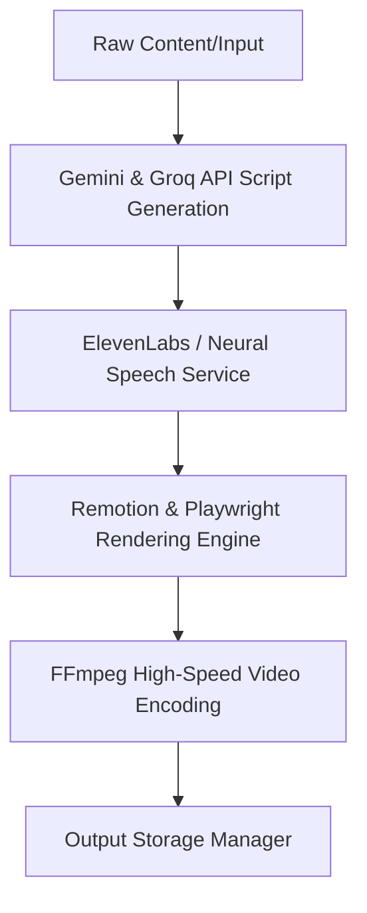

# AI Platforms and Free-Tier API Integration Upgrade Blueprint

This document defines the architectural upgrade blueprint for integrating top-tier AI platforms and high-performance free-tier APIs (Groq, Gemini API, Hugging Face Inference, ElevenLabs free tier, Remotion, and FFmpeg) into the existing IDD Refrigeração production pipeline [`motion_graphics_renderer/pipeline.js`](motion_graphics_renderer/pipeline.js:1).

---

## 1. Executive Summary & Core Objectives

The primary goal of this upgrade is to accelerate video rendering, enhance script generation quality, achieve hyper-realistic neural voice synthesis, and automate dynamic visual rendering—all while maintaining the stability and backward compatibility of the core orchestration pipeline in [`motion_graphics_renderer/pipeline.js`](motion_graphics_renderer/pipeline.js:1).

---

## 2. API & Service Integration Matrix

| Service / Tool | Integration Layer | Target Improvement | Free-Tier / Rate Limit Strategy |
| :--- | :--- | :--- | :--- |
| **Groq API** | Text Generation Module (`producao_yt/`) | Ultra-fast scriptwriting & content structuring (Llama 3 / Mixtral) | High tokens-per-second, generous free tier; implement request batching & exponential backoff |
| **Gemini API (Free Tier)** | Script & Metadata Analysis Module | Multimodal content understanding, SEO metadata generation | Strict rate-limit tracking (RPM/RPD) with local caching fallback |
| **Hugging Face Inference API** | NLP & Classification / B-Roll Tagging | Semantic segmentation, keyword extraction, and visual asset recommendation | Fallback model rotation across serverless endpoints |
| **ElevenLabs (Free Tier)** | [`motion_graphics_renderer/audio_service/index.js`](motion_graphics_renderer/audio_service/index.js:1) | Neural speech synthesis with emotional modulation (Antonio Voice) | Character quota management, caching generated audio segments |
| **Remotion** | Rendering Service (`motion_graphics_renderer/rendering_service/`) | Programmatic React-based motion graphics & dynamic overlays | Headless execution alongside Playwright for complex template rendering |
| **FFmpeg** | [`motion_graphics_renderer/video_encoding_service/index.js`](motion_graphics_renderer/video_encoding_service/index.js:1) | Hardware-accelerated video encoding, noise reduction, & muxing | Local binary utilization with optimized CRF presets |

---

## 3. Detailed Component Integration Strategy

### 3.1 Script Generation & LLM Acceleration (Groq & Gemini)
- **Groq LPU Integration**: Replace legacy sequential text generation calls with asynchronous Groq client requests using models like `llama3-70b-8192`. This cuts script generation latency from seconds to milliseconds.
- **Gemini Multimodal Verification**: Utilize Gemini free tier for analyzing raw source videos, technical refrigeration manuals, and slides (e.g., [`producao_yt/test_slides/slide_5.png`](producao_yt/test_slides/slide_5.png:1)) to extract key talking points before script synthesis.

### 3.2 Neural Speech Synthesis (ElevenLabs & Local Fallback)
- **Hybrid Voice Service**: Upgrade [`motion_graphics_renderer/app_service/antonioVoiceService.js`](motion_graphics_renderer/app_service/antonioVoiceService.js:1) to interface with ElevenLabs API for top-tier neural narration.
- **Quota Protection & Caching**: Implement a content-hash caching layer in [`motion_graphics_renderer/audio_service/index.js`](motion_graphics_renderer/audio_service/index.js:1). If a script segment hash matches an existing audio file in `outputs/audio_cache/`, skip API invocation.

### 3.3 Visual Rendering & Motion Graphics (Remotion & Playwright)
- **Modular Renderer Expansion**: Integrate Remotion alongside existing Playwright headless browser rendering in [`motion_graphics_renderer/renderFrame.js`](motion_graphics_renderer/renderFrame.js:1). This allows React-based parametric components to render complex animations directly into frame sequences.
- **Dynamic B-Roll Injection**: Use Hugging Face image/video classification models to match keywords in the script with appropriate background visual assets.

### 3.4 High-Speed Video Encoding & Audio Muxing (FFmpeg)
- **Optimized Encoding Pipeline**: Enhance [`motion_graphics_renderer/video_encoding_service/index.js`](motion_graphics_renderer/video_encoding_service/index.js:1) with hardware acceleration flags (`libx264` / `nvenc`) and multi-pass audio/video sync.

---

## 4. Implementation Roadmap & Milestones

1. **Phase 1: API Client Abstraction & Caching**
   - Implement unified wrapper classes for Groq and Gemini clients with rate-limit handling and response caching.
2. **Phase 2: Audio Service Upgrade**
   - Integrate ElevenLabs free tier into [`motion_graphics_renderer/audio_service/index.js`](motion_graphics_renderer/audio_service/index.js:1) with SHA-256 segment caching.
3. **Phase 3: Rendering & Encoding Optimization**
   - Connect Remotion components into [`motion_graphics_renderer/pipeline.js`](motion_graphics_renderer/pipeline.js:1) and tune FFmpeg encoding profiles.
4. **Phase 4: End-to-End Pipeline Validation**
   - Run integration tests across the complete modernized workflow.
